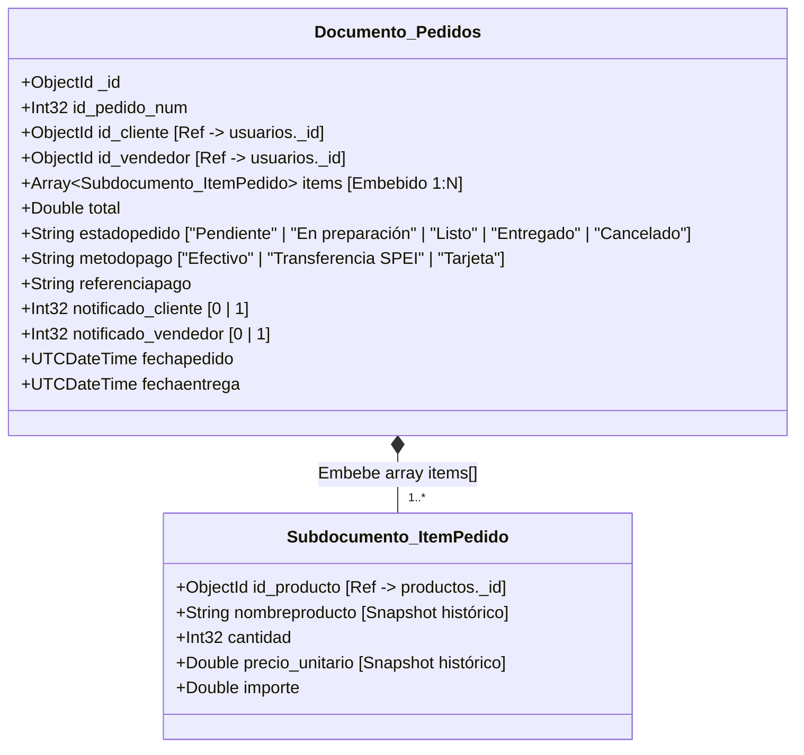
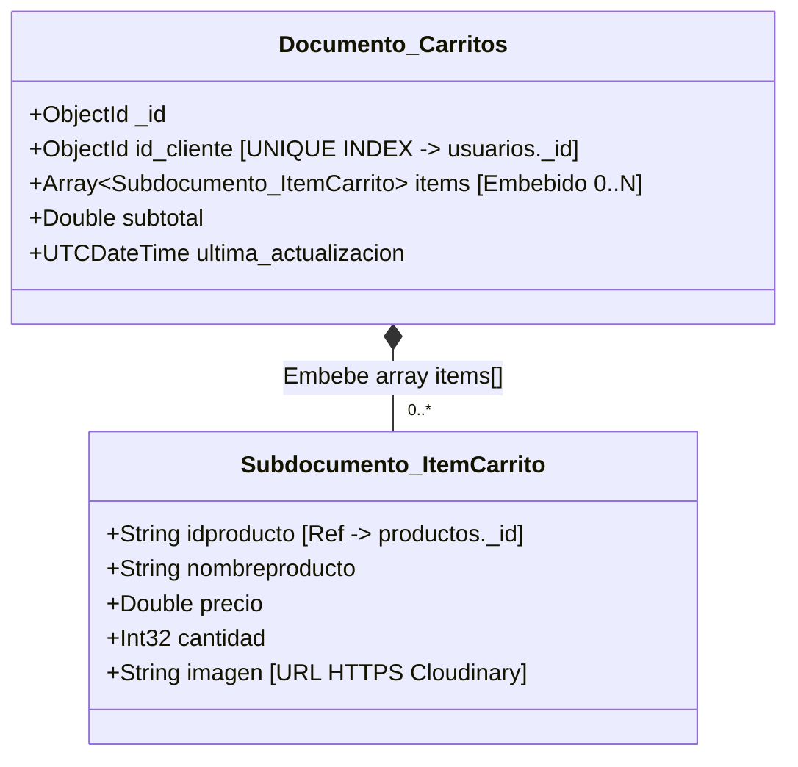
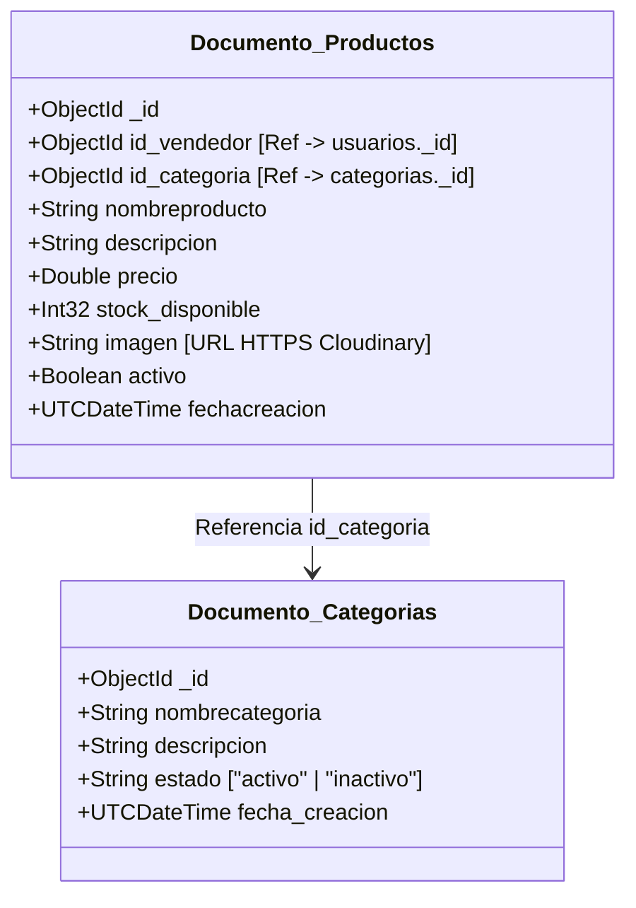
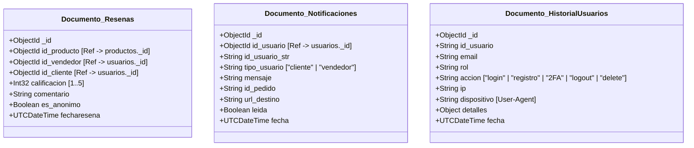
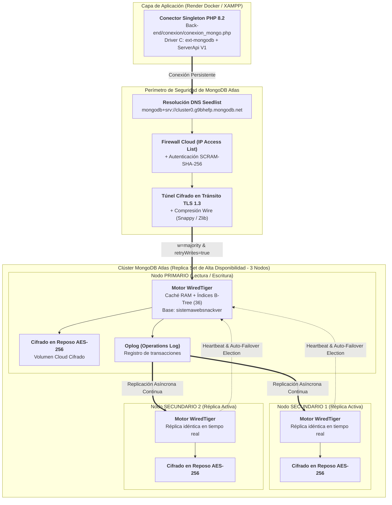
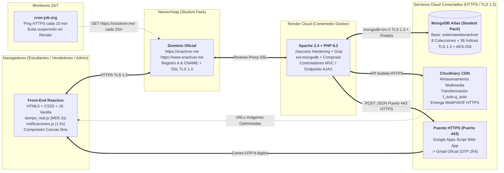
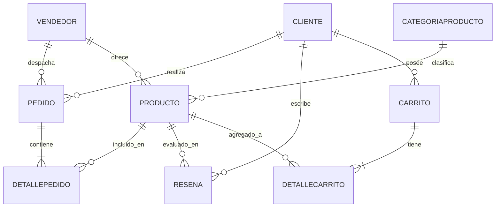
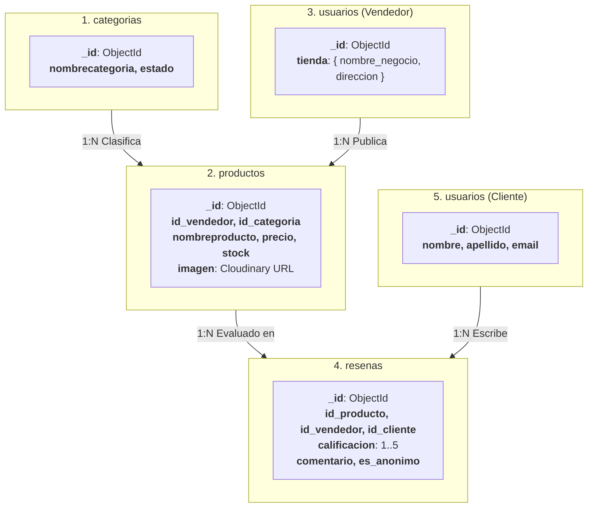
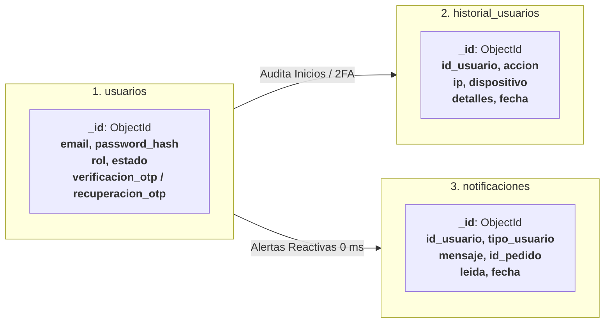
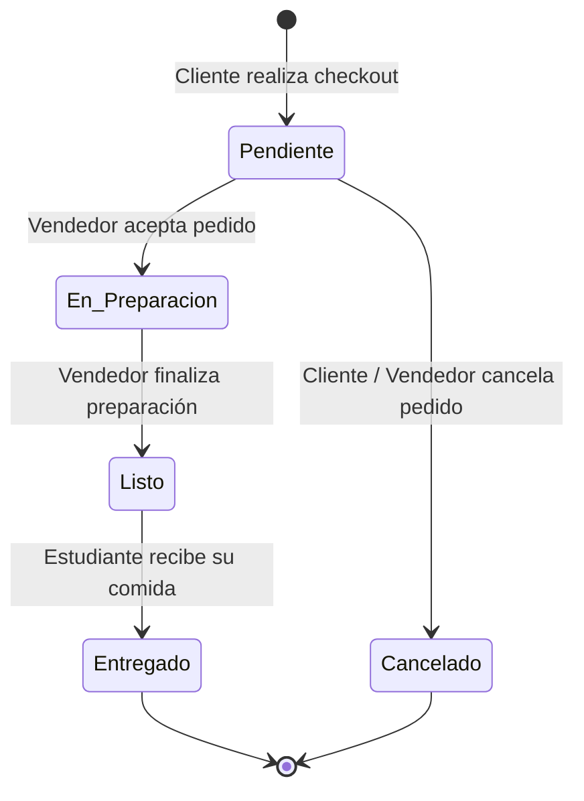

# Diagramas de Base de Datos y Arquitectura NoSQL - Snackver (Unidad 2)

Este documento concentra todos los diagramas exigidos en la rúbrica de la **Unidad 2** para la plataforma **Snackver**:
1. **Diagrama de Documentos (Estructura BSON y Subdocumentos Embebidos)**
2. **Diagramas de Arquitectura de MongoDB Atlas y Nube**
3. **Diagrama de Modelo de Datos (Collections, Comparativa Relacional vs NoSQL y 36 Índices)**

---

## 1. Diagrama de Documentos (Estructura BSON y Subdocumentos Embebidos)

En **MongoDB Atlas**, los documentos se almacenan en formato **BSON (Binary JSON)** aprovechando el patrón de **Embedding (Subdocumentos y Arreglos Embebidos)** para evitar operaciones `JOIN` costosas y preservar snapshots históricos de precios y platillos.

### 1.1 Documento `usuarios` (con Subdocumentos Embebidos `tienda`, `verificacion_otp` y `recuperacion_otp`)

```mermaid
classDiagram
    class Documento_Usuarios {
        +ObjectId _id
        +String nombre
        +String apellido
        +String email [UNIQUE INDEX]
        +String telefono
        +String password_hash [bcrypt]
        +String rol ["cliente" | "vendedor" | "admin"]
        +String estado ["pendiente_verificacion" | "activo" | "inactivo"]
        +UTCDateTime fecharegistro
        +Subdocumento tienda [Embebido si rol == vendedor]
        +Subdocumento verificacion_otp [Embebido 2FA]
        +Subdocumento recuperacion_otp [Embebido Recuperación]
    }

    class Subdocumento_Tienda {
        +String nombre_negocio
        +String descripcion
        +String direccion
        +String foto_negocio [URL HTTPS Cloudinary]
    }

    class Subdocumento_VerificacionOTP {
        +String codigo [6 dígitos]
        +UTCDateTime expira [+15 min]
        +UTCDateTime creado
    }

    class Subdocumento_RecuperacionOTP {
        +String codigo [6 dígitos]
        +UTCDateTime expira [+15 min]
        +Boolean verificado
    }

    Documento_Usuarios *-- Subdocumento_Tienda : Embebe (1:1)
    Documento_Usuarios *-- Subdocumento_VerificacionOTP : Embebe (1:1)
    Documento_Usuarios *-- Subdocumento_RecuperacionOTP : Embebe (1:1)
```

- **Justificación del Embedding:** Los datos comerciales de la tienda (`tienda`) y los códigos temporales de segundo factor (`verificacion_otp`, `recuperacion_otp`) pertenecen exclusivamente al usuario en una relación `1:1`. Embeberlos permite consultar o validar un usuario en una única lectura/escritura atómica.

---

### 1.2 Documento `pedidos` (con Arreglo de Subdocumentos Embebidos `items[]` — Cero JOINs)



- **Justificación del Embedding:** Reemplaza las antiguas tablas `pedido` y `detallepedido`. Al embeber el array `items[]`, cada pedido conserva el nombre y precio exacto del platillo al momento de la compra (*snapshot histórico*) y se carga completo en `MisPedidos.php` y `pedidos_pendientes.php` sin ningún `JOIN`.

---

### 1.3 Documento `carritos` (con Arreglo Embebido `items[]` — Gestión Dinámica)



---

### 1.4 Documentos de Catálogo Comercial (`productos` y `categorias`)



---

### 1.5 Documentos de Interacción Social y Trazabilidad (`resenas`, `notificaciones`, `historial_usuarios`)



---

## 2. Diagramas de Arquitectura de MongoDB Atlas y Nube

### 2.1 Arquitectura Interna del Clúster MongoDB Atlas (Replica Set de 3 Nodos, Motor WiredTiger y Cifrado AES-256)



### 2.2 Arquitectura Cloud Integral End-to-End (`snackver.me` + Render + Atlas + Cloudinary + Puente HTTPS 443)



---

## 3. Modelo Relacional Original (MySQL - Histórico) vs Modelo de Datos NoSQL (Collections)

### 3.1 Modelo Relacional Histórico (10 Tablas en MySQL)
El sistema original utilizaba 10 tablas relacionales normalizadas que requerían múltiples operaciones `JOIN` para consultar carritos, detalles de pedidos y productos:
- `cliente`, `vendedor`, `categoriaproducto`, `producto`, `carrito`, `detallecarrito`, `pedido`, `detallepedido`, `resena`, `notificaciones`.



> **Nota:** La definición histórica y el volcado SQL de este esquema se encuentran archivados como respaldo en [`documentacion/legacy_mysql/`](./legacy_mysql/).

---

### 3.2 Diagramas de Modelo de Datos NoSQL por Módulos Funcionales (Cero Cruce de Líneas)

En lugar de un megadiagrama complejo con líneas cruzadas, el modelo documental NoSQL de Snackver se divide en 3 módulos de flujo lineales y claros:

#### 3.2.1 Módulo Transaccional: Flujo de Compras, Carrito y Pedidos (Cero JOINs)

```mermaid
flowchart LR
    subgraph Col_Usuarios["1. usuarios"]
        U["<b>_id</b>: ObjectId<br><b>rol</b>: cliente / vendedor<br><b>tienda</b>: { ... }"]
    end

    subgraph Col_Carritos["2. carritos"]
        CA["<b>_id</b>: ObjectId<br><b>id_cliente</b>: ObjectId [Único]<br><b>items[]</b>: [ { idproducto, precio, cantidad } ]<br><b>subtotal</b>: Double"]
    end

    subgraph Col_Pedidos["3. pedidos"]
        P["<b>_id</b>: ObjectId<br><b>id_cliente, id_vendedor</b><br><b>items[]</b>: [ { id_producto, nombre, precio, importe } ]<br><b>total, estadopedido, metodopago</b>"]
    end

    subgraph Col_Productos["4. productos"]
        PR["<b>_id</b>: ObjectId<br><b>nombreproducto, precio</b><br><b>stock_disponible</b>: Int32"]
    end

    Col_Usuarios -->|1:1 id_cliente| Col_Carritos
    Col_Carritos -->|Checkout items[]| Col_Pedidos
    Col_Pedidos -->|Descuento stock $inc| Col_Productos
```

#### 3.2.2 Módulo de Catálogo y Valoraciones: Categorías, Platillos y Reseñas



#### 3.2.3 Módulo de Seguridad y Alertas: Auditoría Forense y Notificaciones en Tiempo Real



---

## 4. Catálogo Completo de los 36 Índices en MongoDB Atlas (Simples, Únicos y Compuestos)

| Colección | Nombre del Índice | Claves del Índice | Tipo | Propósito y Consulta Acelerada |
|---|---|---|---|---|
| **`usuarios`** | `uniq_email` | `{ email: 1 }` | Único | Login instantáneo y garantía de emails no duplicados. |
| **`usuarios`** | `idx_rol` | `{ rol: 1 }` | Simple | Filtrado rápido de usuarios por rol (admin/cliente/vendedor). |
| **`usuarios`** | `idx_usuarios_rol_estado` | `{ rol: 1, estado: 1 }` | Compuesto | Listados de administración y verificación de cuentas activas. |
| **`categorias`** | `idx_nombrecategoria` | `{ nombrecategoria: 1 }` | Simple | Búsqueda por nombre de categoría en el catálogo. |
| **`categorias`** | `idx_cat_estado_nombre` | `{ estado: 1, nombrecategoria: 1 }` | Compuesto | Carga optimizada de categorías activas ordenadas por nombre. |
| **`productos`** | `idx_vendedor` | `{ id_vendedor: 1 }` | Simple | Carga de platillos en el panel del vendedor (`Misplatillos.php`). |
| **`productos`** | `idx_categoria` | `{ id_categoria: 1 }` | Simple | Filtrado de productos por categoría en catálogo del cliente. |
| **`productos`** | `idx_activo` | `{ activo: 1 }` | Simple | Exclusión de platillos pausados del catálogo público. |
| **`productos`** | `idx_prod_vendedor_stock` | `{ id_vendedor: 1, stock_disponible: 1 }` | Compuesto | Control de inventario y alertas de stock bajo por vendedor. |
| **`productos`** | `idx_prod_cat_stock` | `{ id_categoria: 1, stock_disponible: 1 }` | Compuesto | Disponibilidad inmediata de alimentos por categoría. |
| **`productos`** | `idx_prod_estado` | `{ estado: 1 }` | Simple | Compatibilidad de estado en filtros del catálogo. |
| **`productos`** | `idx_prod_estado_vendedor` | `{ estado: 1, id_vendedor: 1 }` | Compuesto | Gestión de platillos activos/inactivos por vendedor. |
| **`pedidos`** | `idx_pedidos_cliente` | `{ id_cliente: 1 }` | Simple | Historial de compras del cliente. |
| **`pedidos`** | `idx_pedidos_vendedor` | `{ id_vendedor: 1 }` | Simple | Bandeja general de pedidos del vendedor. |
| **`pedidos`** | `idx_pedidos_fecha` | `{ fechapedido: -1 }` | Simple | Ordenamiento cronológico global de pedidos. |
| **`pedidos`** | `idx_pedidos_cli_notif` | `{ id_cliente: 1, notificado_cliente: 1 }` | Compuesto | Sincronización reactiva de cambios de estado al cliente. |
| **`pedidos`** | `idx_pedidos_ven_notif` | `{ id_vendedor: 1, notificado_vendedor: 1 }` | Compuesto | Detección reactiva de nuevos pedidos entrantes al vendedor. |
| **`pedidos`** | `idx_pedidos_cli_fecha` | `{ id_cliente: 1, fechapedido: -1 }` | Compuesto | Listado cronológico de pedidos del cliente. |
| **`pedidos`** | `idx_pedidos_ven_estado` | `{ id_vendedor: 1, estadopedido: 1 }` | Compuesto | Contador rápido de pedidos pendientes por vendedor. |
| **`pedidos`** | `idx_pedidos_estado` | `{ estado: 1 }` | Simple | Búsqueda por estado compatible en agregaciones. |
| **`pedidos`** | `idx_pedidos_ven_fecha` | `{ id_vendedor: 1, fechapedido: -1 }` | Compuesto | Dashboards del vendedor y KPIs de tiempo real. |
| **`pedidos`** | `idx_pedidos_ven_est_fecha` | `{ id_vendedor: 1, estadopedido: 1, fechapedido: -1 }` | Compuesto | Filtrado instantáneo por estado en `pedidos_pendientes.php`. |
| **`pedidos`** | `idx_pedidos_cli_est_fecha` | `{ id_cliente: 1, estadopedido: 1, fechapedido: -1 }` | Compuesto | Filtrado instantáneo por estado en `MisPedidos.php` del cliente. |
| **`carritos`** | `uniq_carrito_cliente` | `{ id_cliente: 1 }` | Único | Garantiza un único carrito activo por cliente. |
| **`carritos`** | `idx_carritos_cliente` | `{ id_cliente: 1 }` | Simple | Búsqueda y actualización ultrarrápida del carrito. |
| **`resenas`** | `idx_resena_producto` | `{ id_producto: 1 }` | Simple | Carga de opiniones y promedio de estrellas por platillo. |
| **`resenas`** | `idx_resena_cliente` | `{ id_cliente: 1 }` | Simple | Historial de valoraciones emitidas por un estudiante. |
| **`resenas`** | `idx_resenas_fecha` | `{ fecharesena: -1 }` | Simple | Ordenamiento cronológico de reseñas en portada (`index.php`). |
| **`historial_usuarios`** | `idx_historial_fecha` | `{ fecha: -1 }` | Simple | Bitácora de auditoría cronológica más reciente. |
| **`historial_usuarios`** | `idx_historial_usuario_fecha`| `{ id_usuario: 1, fecha: -1 }` | Compuesto | Auditoría de acciones realizadas por un usuario específico. |
| **`historial_usuarios`** | `idx_historial_accion_fecha` | `{ accion: 1, fecha: -1 }` | Compuesto | Filtro de auditoría por tipo de acción (login, 2FA, delete). |
| **`notificaciones`** | `id_usuario_1` | `{ id_usuario: 1 }` | Simple | Recuperación de notificaciones del usuario. |
| **`notificaciones`** | `fecha_-1` | `{ fecha: -1 }` | Simple | Orden cronológico descendente general. |
| **`notificaciones`** | `idx_notif_usr_tipo_fecha` | `{ id_usuario: 1, tipo_usuario: 1, fecha: -1 }` | Compuesto | `NotificacionService::obtenerNotificaciones()` ordenado. |
| **`notificaciones`** | `idx_notif_usrstr_tipo_fecha` | `{ id_usuario_str: 1, tipo_usuario: 1, fecha: -1 }` | Compuesto | Búsquedas flexibles por ID de usuario en string. |
| **`notificaciones`** | `idx_notif_usr_leida` | `{ id_usuario: 1, tipo_usuario: 1, leida: 1 }` | Compuesto | Conteo instantáneo de notificaciones no leídas (badge rojo). |

---

## 5. Ciclo de Vida y Flujo de Estados de un Pedido


