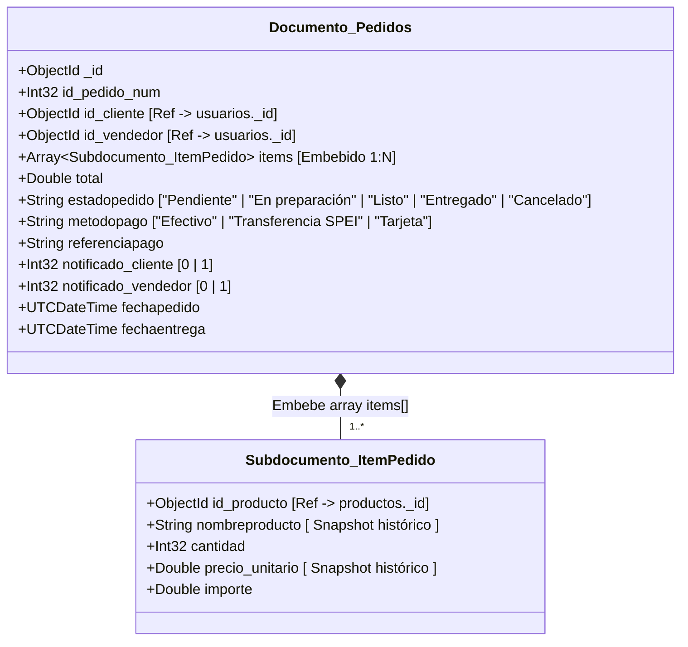
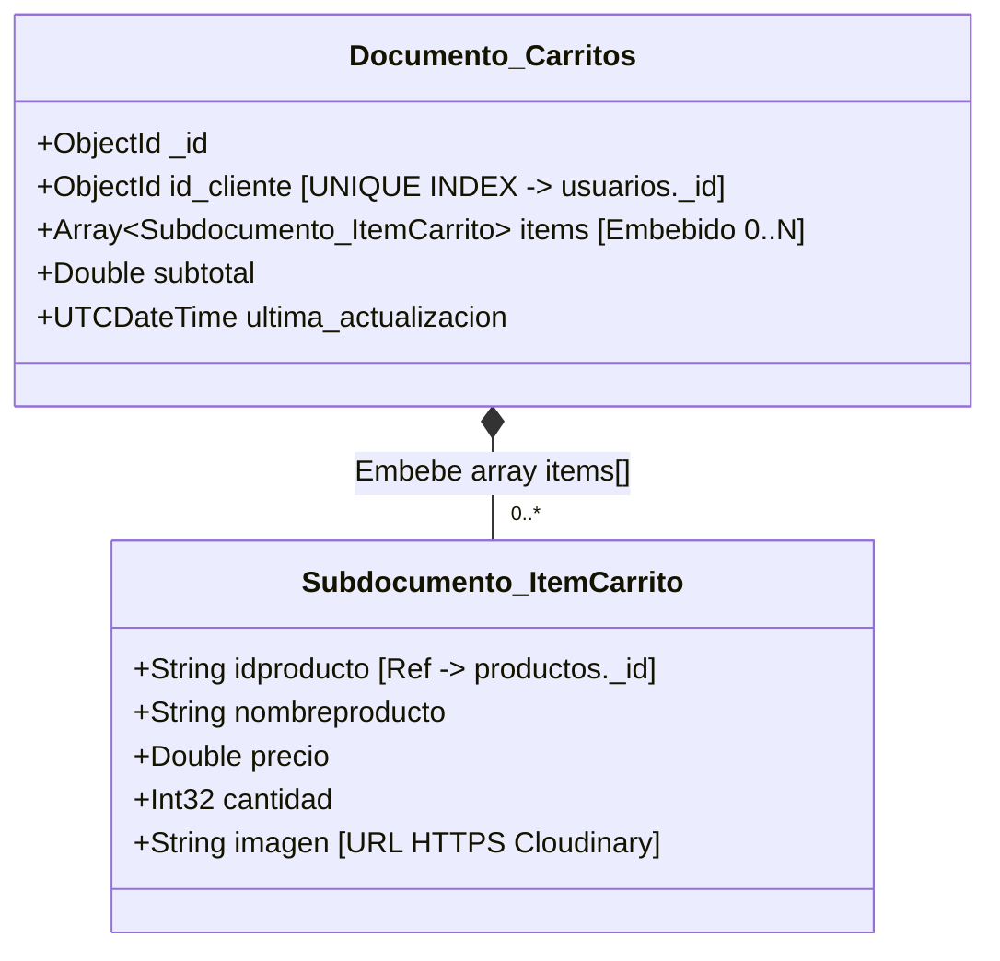
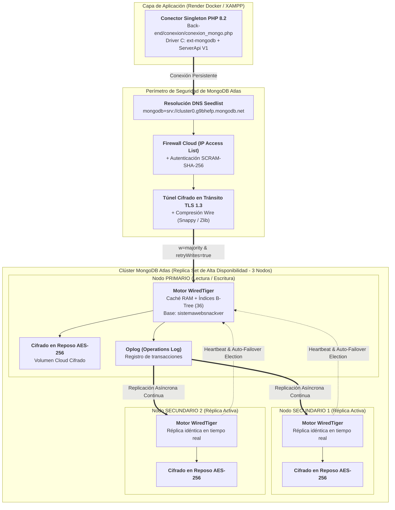
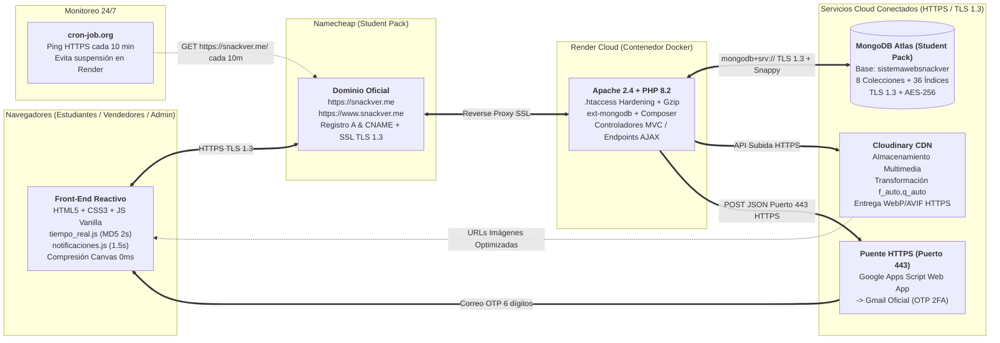
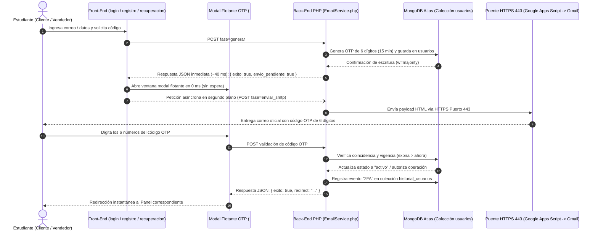
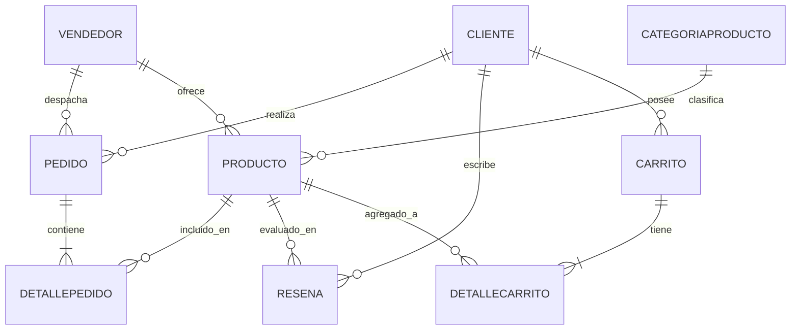
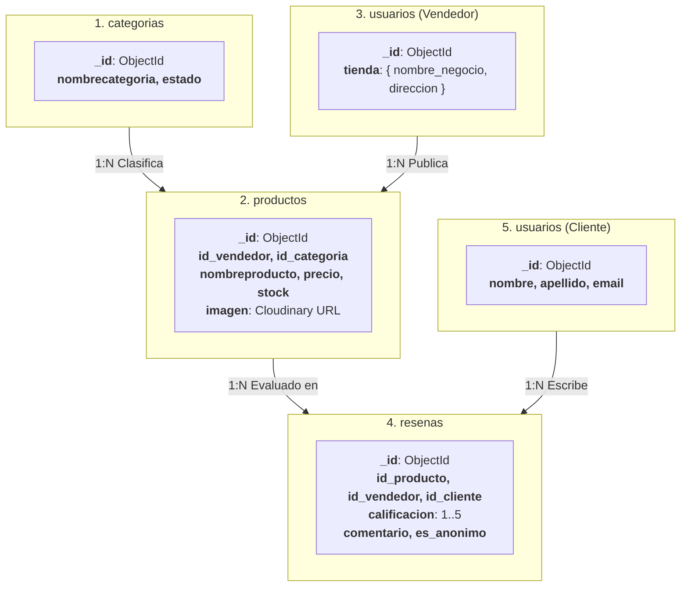
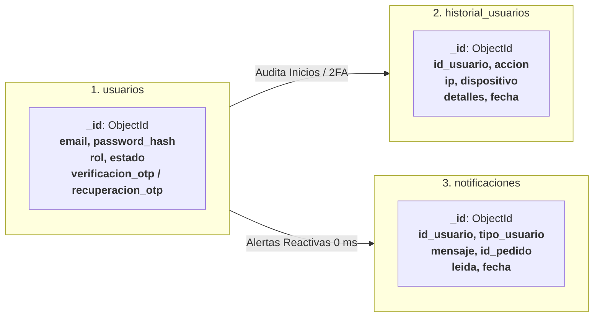
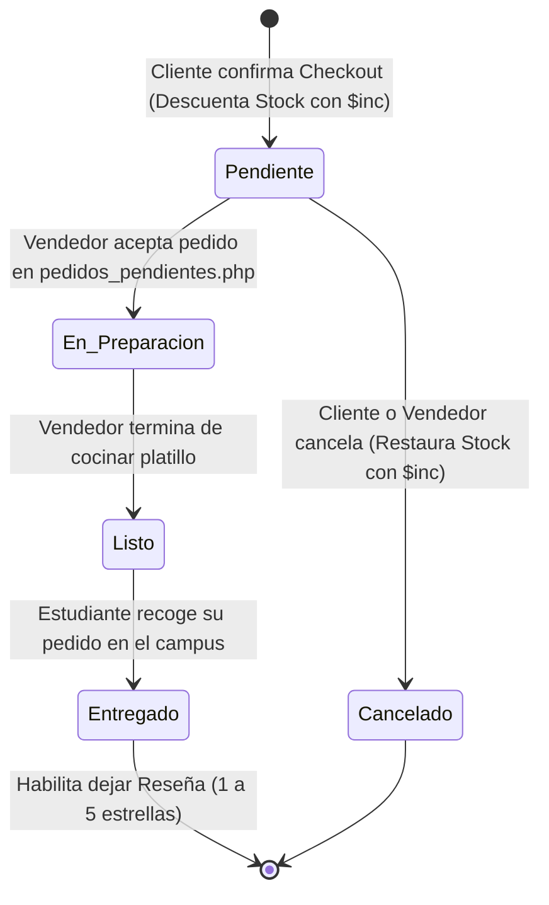

# DOCUMENTO TÉCNICO — UNIDAD 2: BASES DE DATOS NoSQL, SEGURIDAD MULTICAPA Y DESPLIEGUE CLOUD

---

<div align="center">

## HOJA DE PRESENTACIÓN

### **TECNOLÓGICO NACIONAL DE MÉXICO**
#### **INSTITUTO TECNOLÓGICO DE VERACRUZ**


<br>

**CARRERA:**  
Ingeniería en Sistemas Computacionales

**MATERIA / UNIDAD:**  
Administración y Taller de Bases de Datos — **Unidad 2: Bases de Datos NoSQL, Seguridad y Despliegue en la Nube**

**NOMBRE DEL PROYECTO:**  
**SNACKVER** — *Plataforma Web de Entrega y Coordinación de Comida Universitaria en Tiempo Real*

**PRESENTA:**  
**Juan Vicente Herrera Vivanco**

**DOMINIO OFICIAL EN PRODUCCIÓN (HTTPS / SSL):**  
[https://snackver.me](https://snackver.me) | [https://www.snackver.me](https://www.snackver.me)

**REPOSITORIO OFICIAL EN GITHUB:**  
[https://github.com/juanito2255/juanito2255.github.io](https://github.com/juanito2255/juanito2255.github.io)

**LUGAR Y FECHA:**  
H. Veracruz, Ver., Octubre de 2026

</div>

---

## ÍNDICE GENERAL

1. [Introducción](#1-introduccion)
2. [Contenido: Proceso Completo de Implementación por cada Requisito del Profesor y su Integración con las Vistas](#2-contenido-proceso-completo-de-implementacion-por-cada-requisito-del-profesor-y-su-integracion-con-las-vistas)
   - 2.1 [Requisito 1: Modernización de Base de Datos y Migración de SQL a MongoDB Atlas](#21-requisito-1-modernizacion-de-base-de-datos-y-migracion-de-sql-a-mongodb-atlas)
   - 2.2 [Requisito 2: Implementación de Servicios del GitHub Student Developer Pack](#22-requisito-2-implementacion-de-servicios-del-github-student-developer-pack)
   - 2.3 [Requisito 3: Seguridad — Control de Acceso por Roles, Hashing Bcrypt y Autenticación 2FA (OTP en 0 ms)](#23-requisito-3-seguridad--control-de-acceso-por-roles-hashing-bcrypt-y-autenticacion-2fa-otp-en-0-ms)
   - 2.4 [Requisito 4: Cifrado en Tránsito (TLS 1.3 / HTTPS) y Cifrado del Lado de la Base de Datos (AES-256)](#24-requisito-4-cifrado-en-transito-tls-13--https-y-cifrado-del-lado-de-la-base-de-datos-aes-256)
   - 2.5 [Requisito 5: Hardening de Red (Firewall Cloud, SSL/TLS, Protección de Servidor Apache)](#25-requisito-5-hardening-de-red-firewall-cloud-ssltls-proteccion-de-servidor-apache)
   - 2.6 [Requisito 6: Consultas CRUD Nativas NoSQL, Pipelines de Agregación y Comandos](#26-requisito-6-consultas-crud-nativas-nosql-pipelines-de-agregacion-y-comandos)
   - 2.7 [Requisito 7: Motor de Sincronización en Tiempo Real (0 ms), 36 Índices y Almacenamiento Cloud en Cloudinary](#27-requisito-7-motor-de-sincronizacion-en-tiempo-real-0-ms-36-indices-y-almacenamiento-cloud-en-cloudinary)
   - 2.8 [Requisito 8: Despliegue en la Nube (Docker + GitHub + Render + Namecheap + Keep-Alive 24/7)](#28-requisito-8-despliegue-en-la-nube-docker--github--render--namecheap--keep-alive-247)
3. [Diagrama de Documentos (Estructura BSON y Subdocumentos Embebidos en MongoDB)](#3-diagrama-de-documentos-estructura-bson-y-subdocumentos-embebidos-en-mongodb)
   - 3.1 [Documento `usuarios` (con Subdocumentos Embebidos `tienda`, `verificacion_otp` y `recuperacion_otp`)](#31-documento-usuarios-con-subdocumentos-embebidos-tienda-verificacion_otp-y-recuperacion_otp)
   - 3.2 [Documento `pedidos` (con Arreglo de Subdocumentos Embebidos `items[]` — Cero JOINs)](#32-documento-pedidos-con-arreglo-de-subdocumentos-embebidos-items--cero-joins)
   - 3.3 [Documento `carritos` (con Arreglo Embebido `items[]` y Subtotal Dinámico)](#33-documento-carritos-con-arreglo-embebido-items-y-subtotal-dinamico)
   - 3.4 [Documentos `productos`, `categorias`, `resenas`, `notificaciones` e `historial_usuarios`](#34-documentos-productos-categorias-resenas-notificaciones-e-historial_usuarios)
4. [Diagramas de Arquitectura de MongoDB y Nube](#4-diagramas-de-arquitectura-de-mongodb-y-nube)
   - 4.1 [Diagrama de Arquitectura Interna del Clúster MongoDB Atlas (Replica Set de 3 Nodos, WiredTiger y Seguridad)](#41-diagrama-de-arquitectura-interna-del-cluster-mongodb-atlas-replica-set-de-3-nodos-wiredtiger-y-seguridad)
   - 4.2 [Diagrama de Arquitectura Cloud End-to-End en Producción (`snackver.me` + Render + Atlas + Cloudinary + Gmail Relay)](#42-diagrama-de-arquitectura-cloud-end-to-end-en-produccion-snackverme--render--atlas--cloudinary--gmail-relay)
   - 4.3 [Diagrama de Secuencia de Autenticación 2FA OTP en 0 ms y Despacho Asíncrono](#43-diagrama-de-secuencia-de-autenticacion-2fa-otp-en-0-ms-y-despacho-asincrono)
5. [Diagrama de Modelo de Datos (Collections, Relaciones e Índices)](#5-diagrama-de-modelo-de-datos-collections-relaciones-e-indices)
   - 5.1 [Comparativa: Modelo Relacional Histórico (10 Tablas MySQL) vs. Modelo NoSQL (8 Colecciones MongoDB)](#51-comparativa-modelo-relacional-historico-10-tablas-mysql-vs-modelo-nosql-8-colecciones-mongodb)
   - 5.2 [Diagrama General del Modelo de Datos NoSQL (8 Colecciones, Referencias `ObjectId` y Documentos Embebidos)](#52-diagrama-general-del-modelo-de-datos-nosql-8-colecciones-referencias-objectid-y-documentos-embebidos)
   - 5.3 [Diagrama de Estados del Ciclo de Vida de un Pedido](#53-diagrama-de-estados-del-ciclo-de-vida-de-un-pedido)
   - 5.4 [Catálogo Completo de los 36 Índices en MongoDB Atlas](#54-catalogo-completo-de-los-36-indices-en-mongodb-atlas)
6. [Catálogo de Vistas Programadas del Sistema (Front-End y Back-End en Producción — Sustitución de Vistas de Figma)](#6-catalogo-de-vistas-programadas-del-sistema-front-end-y-back-end-en-produccion--sustitucion-de-vistas-de-figma)
   - 6.1 [Módulo Público y Descubrimiento](#61-modulo-publico-y-descubrimiento)
   - 6.2 [Módulo de Seguridad, Autenticación y 2FA OTP (Modal en 0 ms)](#62-modulo-de-seguridad-autenticacion-y-2fa-otp-modal-en-0-ms)
   - 6.3 [Módulo Estudiante / Cliente](#63-modulo-estudiante--cliente)
   - 6.4 [Módulo Vendedor Universitario](#64-modulo-vendedor-universitario)
   - 6.5 [Módulo Administrador y Auditoría](#65-modulo-administrador-y-auditoria)
7. [Conclusión](#7-conclusion)

---

## 1. INTRODUCCIÓN

**Snackver** (*"Comida entre universitarios"*) es una plataforma web desarrollada para coordinar pedidos y entregas de alimentos dentro del Instituto Tecnológico de Veracruz, conectando a estudiantes emprendedores con la comunidad académica.

En la Unidad 1, el sistema operó con una base de datos relacional MySQL local (10 tablas normalizadas). Dicha arquitectura presentó limitaciones de rendimiento por múltiples `JOINs` en historial y pedidos, almacenamiento local volátil de imágenes no apto para contenedores cloud, y carencia de autenticación multifactor (2FA).

En la Unidad 2, la plataforma se migró íntegramente a **MongoDB Atlas** (8 colecciones NoSQL y 36 índices B-Tree), eliminando al 100% las consultas SQL. Se incorporaron dos beneficios de GitHub Student Pack (MongoDB Atlas M0 y Namecheap con SSL), Cloudinary CDN para imágenes, autenticación 2FA OTP en 0 ms vía HTTPS y despliegue continuo en Render Docker bajo **[https://snackver.me](https://snackver.me)**.


---

## 2. CONTENIDO: PROCESO COMPLETO DE IMPLEMENTACIÓN POR CADA REQUISITO DEL PROFESOR Y SU INTEGRACIÓN CON LAS VISTAS

A continuación se explica de principio a fin el proceso técnico seguido para cumplir cada uno de los **8 requisitos establecidos por el profesor**, detallando cómo se construyó en el Back-End y cómo interactúa directamente con las vistas reales del Front-End.

---

### 2.1 Requisito 1: Modernización de Base de Datos y Migración de SQL a MongoDB Atlas

#### Proceso de Principio a Fin:
1. **Resguardo del Esquema Relacional:** Se archivó el esquema original de 10 tablas MySQL en `documentacion/legacy_mysql/` como referencia histórica y punto de partida.
2. **Rediseño Orientado a Documentos (Desnormalización Estratégica):** Se transformaron las 10 tablas relacionales en **8 colecciones NoSQL** en la base de datos `sistemawebsnackver` de MongoDB Atlas (`usuarios`, `categorias`, `productos`, `pedidos`, `carritos`, `resenas`, `notificaciones` e `historial_usuarios`).
   - Las tablas `cliente`, `vendedor` y los administradores se unificaron en una sola colección **`usuarios`** diferenciada por el atributo `rol` (`'cliente'`, `'vendedor'`, `'admin'`), embebiendo los datos de la tienda (`tienda: { nombre_negocio, descripcion, direccion, foto_negocio }`) dentro del propio documento del vendedor.
   - Las tablas maestras y de detalle (`pedido` + `detallepedido` y `carrito` + `detallecarrito`) se fusionaron mediante **arreglos de subdocumentos embebidos (`items: [...]`)**, eliminando por completo la necesidad de realizar `JOINs` al consultar compras o carritos.
3. **Instalación del Driver Nativo y SDK:** Se integró la extensión binaria C **`ext-mongodb`** (`php_mongodb.dll` en Windows / `pecl install mongodb` en Docker Linux) junto con la librería oficial `mongodb/mongodb ^2.5` vía Composer (`Back-end/composer.json`).
4. **Construcción del Conector Singleton (`Back-end/conexion/conexion_mongo.php`):** Se programó la clase `ConexionMongo` bajo el patrón de diseño **Singleton**, reutilizando una única instancia de `MongoDB\Client` por petición HTTP, activando `ServerApi(ServerApi::V1)`, negociación `tls=true` y compresión del protocolo de red `'compressors' => 'snappy,zlib'`.
5. **Scripts de Migración y Semillero (`tools/`):** Se desarrollaron `tools/migrar_mysql_a_mongo.php`, `tools/inicializar_solo_admin.php` y `tools/agregar_categorias_y_resenas.php` para poblar la base de datos en Atlas de forma idempotente.

#### Integración con las Vistas:
- Todas las vistas del proyecto (`index.php`, `Front-end/Productos.php`, `Back-end/cliente/*`, `Back-end/vendedor/*`, `Back-end/admin/*`) incluyen `require_once __DIR__ . '/../conexion/conexion_mongo.php'` e invocan `ConexionMongo::obtenerInstancia()->obtenerBD()`, leyendo y escribiendo documentos BSON directamente en MongoDB Atlas sin una sola línea de SQL.

---

### 2.2 Requisito 2: Implementación de Servicios del GitHub Student Developer Pack

#### Proceso de Principio a Fin:
Se activaron e integraron en producción **2 beneficios oficiales del paquete GitHub Student Developer Pack**:

1. **Servicio 1 — MongoDB Atlas (Cloud Database Service):**
   - A través del beneficio estudiantil de MongoDB en GitHub Education, se aprovisionó el clúster distribuido **`Cluster0`** en **MongoDB Atlas** (`mongodb+srv://cluster0.g9bhefp.mongodb.net/sistemawebsnackver`).
   - El clúster cuenta con un **Replica Set de 3 nodos** (1 Primario y 2 Secundarios con failover automático), copias de seguridad, cifrado AES-256 y monitoreo de operaciones en tiempo real.
2. **Servicio 2 — Namecheap (Dominio `.me` + Certificado SSL):**
   - A través del beneficio estudiantil de Namecheap en GitHub Education, se registró gratuitamente por 1 año el dominio personalizado **[`snackver.me`](https://snackver.me)**.
   - Se configuró la zona **Advanced DNS** en Namecheap apuntando el registro `A (@)` a la IP del balanceador cloud (`216.24.57.1`) y el registro `CNAME (www)` a `juanito2255-github-io.onrender.com.`, activando el certificado criptográfico **SSL/TLS 1.3** para servir todas las vistas bajo `https://snackver.me` y `https://www.snackver.me`.

---

### 2.3 Requisito 3: Seguridad — Control de Acceso por Roles, Hashing Bcrypt y Autenticación 2FA (OTP en 0 ms)

#### Proceso de Principio a Fin:
1. **Control de Acceso Basado en Roles (RBAC):**
   - Cada sesión autenticada almacena `$_SESSION['id_usuario']`, `$_SESSION['rol']` (`'cliente'`, `'vendedor'` o `'admin'`), `$_SESSION['nombre']` y `$_SESSION['email']`.
   - Todas las vistas privadas de `Back-end/admin/`, `Back-end/vendedor/` y `Back-end/cliente/` verifican al inicio del script que la sesión exista y que `$_SESSION['rol']` coincida estrictamente con el módulo solicitado; de lo contrario, redirigen inmediatamente a `Front-end/login.php`.
2. **Erradicación de Texto Plano con Hashing `bcrypt`:**
   - En el registro (`Back-end/conexion/procesar_registro.php`), cambio de contraseña (`Back-end/conexion/procesar_cambiar_password.php`) y creación de usuarios, las contraseñas se cifran irreversiblemente con `password_hash($password, PASSWORD_BCRYPT)` (factor de costo con sal aleatoria integrada) y se guardan en el campo `password_hash` de `usuarios`.
   - En el inicio de sesión (`Back-end/conexion/procesar_login.php`), la validación se realiza mediante `password_verify($password, $usuario['password_hash'])`.
3. **Autenticación de Dos Factores (2FA / OTP de 6 dígitos) con Apertura en 0 ms:**
   - Al registrarse, iniciar sesión en una cuenta pendiente de verificación, recuperar contraseña o actualizar contraseña desde el perfil, el sistema genera un código criptográfico de 6 dígitos (`random_int(100000, 999999)`) con vigencia estricta de **15 minutos** (`UTCDateTime` en MongoDB).
   - **Arquitectura en 2 Fases (0 ms):** Para que el usuario no espere a que el servidor de correo responda antes de ver la ventana donde escribe su código:
     - **Fase 1 (`fase=generar`):** El endpoint PHP guarda el OTP en MongoDB Atlas en ~40 ms y responde inmediatamente `{ "exito": true, "envio_pendiente": true }`. El navegador abre el modal flotante (`#otpModalOverlay`) en **0 milisegundos**.
     - **Fase 2 (`fase=enviar_smtp`):** Mientras el estudiante ya ve el modal con el contador regresivo de 15:00 minutos, el navegador dispara en segundo plano la petición de envío de correo.
   - **Despacho Híbrido de Correo (`Back-end/servicios/EmailService.php`):** Dado que proveedores cloud como Render Free Tier bloquean los puertos SMTP tradicionales (`25`, `465`, `587`), `EmailService` despacha la plantilla HTML corporativa de Snackver a través del **Puerto 443 (HTTPS)** mediante un puente seguro en **Google Apps Script** vinculado a la cuenta oficial `snackveroficial@gmail.com` (`SMTP_HTTP_RELAY_URL`), manteniendo además fallback automático a **PHPMailer SMTPS (Puerto 465 SSL)** en entornos locales XAMPP.
4. **Bitácora de Auditoría (`Back-end/servicios/HistorialService.php`):**
   - Cada inicio de sesión, registro, validación 2FA, cambio de contraseña, cierre de sesión y eliminación de cuenta queda registrado en la colección `historial_usuarios` capturando usuario, correo, rol, acción, dirección IP (`$_SERVER['REMOTE_ADDR']`), navegador (`HTTP_USER_AGENT`) y fecha exacta UTC.

#### Integración con las Vistas:
- **`Front-end/login.php` y `Front-end/registro.php`:** Controlados por `Front-end/js/verificar_modal.js`, abren la ventana flotante de 6 casillas numéricas sin recargar la página.
- **`Front-end/recuperacion_password.php`:** Controlado por `Front-end/js/recuperacion_wizard.js`, guía al usuario en un asistente de 3 pasos (1. Correo $\rightarrow$ 2. Modal OTP 0 ms $\rightarrow$ 3. Nueva Contraseña).
- **`Front-end/cambiar_password.php`:** Controlado por `Front-end/js/cambiar_password.js`, exige validar el código OTP enviado al correo antes de aplicar el cambio de contraseña de un usuario autenticado.
- **`Back-end/admin/historial_usuarios.php`:** Muestra al administrador en tiempo real todas las acciones de seguridad registradas.

---

### 2.4 Requisito 4: Cifrado en Tránsito (TLS 1.3 / HTTPS) y Cifrado del Lado de la Base de Datos (AES-256)

#### Proceso de Principio a Fin:
1. **Cifrado en Tránsito (Data in Transit):**
   - **Navegador $\leftrightarrow$ Servidor Web (`snackver.me`):** Todo el tráfico HTTP se redirige y cifra mediante **HTTPS con TLS 1.3** gestionado entre Namecheap y Render.
   - **Servidor PHP $\leftrightarrow$ MongoDB Atlas:** En `Back-end/conexion/conexion_mongo.php`, el cliente de MongoDB fuerza `'tls' => true` y `'tlsAllowInvalidCertificates' => false` sobre el protocolo `mongodb+srv://`, garantizando que ninguna consulta ni documento BSON viaje en texto claro por internet.
   - **Servidor PHP $\leftrightarrow$ Servicios Cloud Externos:** Tanto la subida de imágenes a **Cloudinary** (`https://res.cloudinary.com/...`) como el envío de correos OTP vía **Google Apps Script** (`https://script.google.com/...`) se ejecutan exclusivamente sobre túneles **HTTPS en el puerto 443**.
2. **Cifrado del Lado de la Base de Datos / En Reposo (Encryption at Rest):**
   - El clúster de **MongoDB Atlas** ejecuta el motor de almacenamiento **WiredTiger** con **cifrado en reposo AES-256 (Advanced Encryption Standard de 256 bits)** activado de fábrica sobre todos los volúmenes de disco y snapshots de respaldo en la nube.

---

### 2.5 Requisito 5: Hardening de Red (Firewall Cloud, SSL/TLS, Protección de Servidor Apache)

#### Proceso de Principio a Fin:
1. **Firewall Perimetral en MongoDB Atlas (IP Access List & Database Access):**
   - Configuración de lista blanca de IPs en el apartado **Network Access** de MongoDB Atlas y autenticación obligatoria SCRAM-SHA-256 con usuario de base de datos dedicado (`readWrite` sobre `sistemawebsnackver`).
2. **Hardening del Servidor Web Apache (`.htaccess`):**
   - Bloqueo estricto de acceso público HTTP a archivos sensibles de configuración y control de versiones: `.env`, `.env.example`, `composer.json`, `composer.lock`, `.git` y `.gitignore` mediante directivas `RewriteRule` y `<FilesMatch>` que devuelven `403 Forbidden`.
   - Desactivación del listado de directorios (`Options -Indexes`).
   - Compresión de salida `mod_deflate` (Gzip) y políticas de caché `mod_expires` con cabeceras `Cache-Control`.
3. **Aislamiento de Credenciales Confidenciales (`vlucas/phpdotenv`):**
   - Ninguna contraseña de base de datos, API Key de Cloudinary ni llave SMTP está escrita en el código fuente. Se leen dinámicamente desde variables de entorno con triple fallback (`$_ENV`, `getenv()`, `$_SERVER`) y el archivo `Back-end/.env` está excluido del repositorio mediante `.gitignore` y `.dockerignore`.

---

### 2.6 Requisito 6: Consultas CRUD Nativas NoSQL, Pipelines de Agregación y Comandos

#### Proceso de Principio a Fin e Integración con las Vistas:
Todas las operaciones de negocio emplean métodos nativos de `MongoDB\Collection`:

| Operación NoSQL | Métodos / Operadores Utilizados | Vistas y Controladores donde Opera |
|---|---|---|
| **CREATE (`insertOne`)** | Inserción de documentos BSON con `ObjectId` y `UTCDateTime`. | • `procesar_registro.php` (nuevo usuario en `usuarios`)<br>• `nuevoplatillo.php` (nuevo platillo en `productos`)<br>• `procesar_pedido.php` (nuevo pedido con `items[]` en `pedidos`)<br>• `categorias.php` (nueva categoría en `categorias`)<br>• `resenas.php` (nueva reseña en `resenas`)<br>• `HistorialService.php` y `NotificacionService.php` |
| **READ (`find`, `findOne`, `countDocuments`)** | Consultas con filtros por `ObjectId`, expresiones regulares insensibles a mayúsculas (`MongoDB\BSON\Regex`), ordenamientos (`sort`) y proyecciones quirúrgicas (`projection`). | • `index.php` y `Productos.php` (catálogo público)<br>• `resultados_busqueda.php` y `BuscarTienda.php` (búsqueda regex)<br>• `MisPedidos.php`, `pedidos_pendientes.php`, `Gestion_platillos.php`<br>• `clientes.php`, `vendedores.php`, `historial_usuarios.php` |
| **AGGREGATE (`aggregate`)** | Pipelines analíticos con etapas `$match`, `$group`, `$sum`, `$avg`, `$sort`, `$limit`, `$lookup` y `$facet`. | • `dashboard_admin.php` (métricas globales de ingresos, conteos por rol y ventas en una sola consulta con `$facet`)<br>• `dashboard_vendedor.php` (cálculo de los 3 KPIs del vendedor)<br>• `ver_tienda.php` e `index.php` (promedios de calificación de estrellas) |
| **UPDATE (`updateOne`, `updateMany`)** | Modificaciones atómicas con operadores `$set`, `$unset`, `$inc`, `$push` y `$pull`. | • `procesar_pedido.php` y `cancelar_pedido_cliente.php` (descuento y devolución atómica de stock con `$inc`)<br>• `carrito.php` (gestión de items del carrito con `$set` / `$push` / `$pull`)<br>• `editar_platillo.php`, `MiTienda.php`, `Miperfil.php`, `editar_cliente.php`, `editar_vendedor.php`, `editar_categoria.php` |
| **DELETE (`deleteOne`, `deleteMany`)** | Eliminación física y limpieza en cascada con registro en auditoría. | • `eliminar_cliente.php` (elimina cliente + su carrito en `carritos`)<br>• `eliminar_vendedor.php` (elimina vendedor + sus platillos en `productos`)<br>• `Misplatillos.php` (eliminación de platillo por el vendedor) |

Además, se programó una suite completa de **14 scripts de comandos CLI en `tools/`** (`verificar_sistema.php`, `optimizar_indices_atlas.php`, `inicializar_solo_admin.php`, `seed_mongo_initial_data.php`, `test_mongo_connection.php`, etc.) para administración y pruebas automatizadas.

---

### 2.7 Requisito 7: Motor de Sincronización en Tiempo Real (0 ms), 36 Índices y Almacenamiento Cloud en Cloudinary

#### Proceso de Principio a Fin:
1. **Motor Diferencial de Tiempo Real por Hash MD5 (`Back-end/conexion/sincronizar_tiempo_real.php` + `Front-end/js/tiempo_real.js`):**
   - Para que las **12 vistas principales** del sistema se actualicen solas sin que el usuario tenga que recargar la página (`F5`), `tiempo_real.js` consulta cada **2 segundos** (y al enfocar la ventana con `focus` / `visibilitychange`) el endpoint `sincronizar_tiempo_real.php` enviando el hash MD5 del estado actual en pantalla.
   - Si los datos en MongoDB Atlas no han cambiado, el servidor responde en ~30 ms `{"status": "unchanged"}` y el navegador **no toca el DOM** (cero parpadeos, respetando lo que el usuario esté escribiendo o su posición de scroll).
   - En cuanto otro usuario crea un platillo, cambia el stock, publica una reseña o edita una categoría, el hash MD5 cambia, el servidor devuelve `{"status": "changed"}` con el fragmento actualizado y la vista se refresca instantáneamente en **0 ms**.
2. **Motor Reactivo de Campana de Notificaciones y Pedidos (`Back-end/js/notificaciones.js` + `Back-end/notificaciones/obtener_notificaciones.php`):**
   - Sincroniza cada **1.5 segundos** la campana de alertas, el contador rojo de notificaciones no leídas, las tarjetas de pedidos del cliente/vendedor y los **3 KPIs numéricos del dashboard del vendedor** (`#kpi-pendientes`, `#kpi-total-general`, `#kpi-total-productos`).
3. **Creación de 36 Índices en MongoDB Atlas (`tools/optimizar_indices_atlas.php`):**
   - Se diseñaron e inyectaron **36 índices simples, únicos y compuestos** en las 8 colecciones para que todas las consultas de tiempo real se resuelvan directamente en memoria RAM (`IXSCAN`) sin escaneos de colección (`COLLSCAN`).
4. **Almacenamiento Multimedia en la Nube con Cloudinary (`Back-end/servicios/CloudinaryService.php`):**
   - En `nuevoplatillo.php`, `editar_platillo.php` y `MiTienda.php`, al elegir una foto se muestra una **previsualización instantánea en 0 ms** con `URL.createObjectURL(file)`, el navegador comprime la imagen en segundo plano mediante `<canvas>` a ~100 KB, y el servidor la sube a **Cloudinary** inyectando los parámetros de optimización automática `/upload/f_auto,q_auto/` (entrega en WebP/AVIF sobre HTTPS).

---

### 2.8 Requisito 8: Despliegue en la Nube (Docker + GitHub + Render + Namecheap + Keep-Alive 24/7)

#### Proceso de Principio a Fin:
1. **Contenedorización con Docker (`Dockerfile` y `.dockerignore`):**
   - Se construyó un `Dockerfile` basado en la imagen oficial `php:8.2-apache`.
   - El contenedor instala las librerías de sistema (`libssl-dev`, `libcurl4-openssl-dev`, `libpng-dev`, `libzip-dev`), compila y habilita la extensión oficial **`pecl install mongodb`**, copia el binario oficial de **Composer 2**, instala las dependencias de `Back-end/composer.json` (`--no-dev --optimize-autoloader`) y activa los módulos de Apache `rewrite`, `deflate`, `expires` y `headers`.
   - Adicionalmente, se configuró el archivo `/usr/local/etc/php/conf.d/snackver.ini` (`output_buffering = 4096`, `display_errors = Off`, `log_errors = On` y zona horaria de México), garantizando que las respuestas JSON de las campanas de notificación y cambios de pedidos en tiempo real se entreguen 100% limpias sin advertencias HTML.
2. **Despliegue Continuo (CI/CD) desde GitHub hacia Render:**
   - Se vinculó el repositorio de GitHub con un **Web Service Docker en Render** (`https://juanito2255-github-io.onrender.com`), inyectando las variables de entorno confidenciales (`MONGO_URI`, `MONGO_DB_NAME`, `CLOUDINARY_*`, `SMTP_*`, `SMTP_HTTP_RELAY_URL`) directamente en el panel de Render.
3. **Blindaje del Repositorio de Código Fuente (GitHub Private Repository + Render GitHub App):**
   - El repositorio oficial (`https://github.com/juanito2255/juanito2255.github.io`) fue configurado en modalidad **Privada** (*Private Repository*) en GitHub, protegiendo el código fuente, la lógica institucional y los esquemas NoSQL del acceso público no autorizado.
   - El acceso para compilación y despliegue se delegó de manera segura a través de la aplicación oficial **Render GitHub App** (*Authorized / Installed GitHub Apps* con permisos granulares por repositorio), permitiendo que Render clone y compile automáticamente el código sin exponer credenciales ni requerir tokens de acceso personal (*PAT*) en texto plano.
4. **Enlace de Dominio Personalizado y SSL con Namecheap:**
   - Se vincularon los dominios `snackver.me` y `www.snackver.me` en Render **Custom Domains** y en **Namecheap Advanced DNS** (`A Record @ -> 216.24.57.1` y `CNAME www -> juanito2255-github-io.onrender.com` con `HTTPS OFF`), obteniendo el certificado SSL automático de Let's Encrypt con candado verde HTTPS.
5. **Disponibilidad 24/7 sin Suspensión (`cron-job.org`) y Gestión de Ciclo de Vida:**
   - Para evitar que el plan gratuito de Render entre en reposo tras 15 minutos de inactividad, se programó un monitor automático en **cron-job.org** que realiza peticiones HTTPS cada **10 minutos** (`*/10 * * * *`) a `https://snackver.me/`, manteniendo el contenedor encendido las 24 horas.
   - Asimismo, el entorno soporta gestión controlada de ciclo de vida mediante las opciones **Suspend Web Service** (para pausar temporalmente el contenedor y ahorrar horas de cómputo conservando intacta la base de datos y la configuración) y **Resume Web Service** (para reactivar el servicio en menos de 60 segundos).

---

## 3. DIAGRAMA DE DOCUMENTOS (ESTRUCTURA BSON Y SUBDOCUMENTOS EMBEBIDOS EN MONGODB)

A diferencia de las bases de datos relacionales donde la información de una entidad se fragmenta en múltiples tablas, en **MongoDB Atlas** los datos que se consultan juntos se almacenan juntos dentro de un mismo documento **BSON (Binary JSON)** mediante **subdocumentos y arreglos embebidos**. A continuación se presenta el diagrama y la explicación detallada de cada documento del sistema.

---

### 3.1 Documento `usuarios` (con Subdocumentos Embebidos `tienda`, `verificacion_otp` y `recuperacion_otp`)

```mermaid
classDiagram
    class Documento_Usuarios {
        +ObjectId _id
        +String nombre
        +String apellido
        +String email [UNIQUE INDEX]
        +String telefono
        +String password_hash [bcrypt]
        +String rol ["cliente" | "vendedor" | "admin"]
        +String estado ["pendiente_verificacion" | "activo" | "inactivo"]
        +UTCDateTime fecharegistro
        +Subdocumento tienda [Embebido si rol == vendedor]
        +Subdocumento verificacion_otp [Embebido 2FA]
        +Subdocumento recuperacion_otp [Embebido Recuperación]
    }

    class Subdocumento_Tienda {
        +String nombre_negocio
        +String descripcion
        +String direccion
        +String foto_negocio [URL HTTPS Cloudinary]
    }

    class Subdocumento_VerificacionOTP {
        +String codigo [6 dígitos]
        +UTCDateTime expira [+15 min]
        +UTCDateTime creado
    }

    class Subdocumento_RecuperacionOTP {
        +String codigo [6 dígitos]
        +UTCDateTime expira [+15 min]
        +Boolean verificado
    }

    Documento_Usuarios *-- Subdocumento_Tienda : Embebe (1:1)
    Documento_Usuarios *-- Subdocumento_VerificacionOTP : Embebe (1:1)
    Documento_Usuarios *-- Subdocumento_RecuperacionOTP : Embebe (1:1)
```

#### Ejemplo Real BSON/JSON del Documento `usuarios`:
```json
{
  "_id": { "$oid": "6718a910e4b0a1c2d3e4f501" },
  "nombre": "Carlos",
  "apellido": "Martínez",
  "email": "carlos.vendedor@veracruz.tecnm.mx",
  "telefono": "2291234567",
  "password_hash": "$2y$10$92IXUNpkjO0rOQ5byMi.Ye4oKoEa3Ro9llC/.og/at2.uheWG/igi",
  "rol": "vendedor",
  "estado": "activo",
  "tienda": {
    "nombre_negocio": "Tacos y Tortas El Inge",
    "descripcion": "Tortas de cochinita y tacos al vapor recién hechos junto al Edificio K.",
    "direccion": "Banca 4 frente al Laboratorio de Cómputo",
    "foto_negocio": "https://res.cloudinary.com/demo/image/upload/f_auto,q_auto/v1/snackver_platillos/tienda_inge.webp"
  },
  "verificacion_otp": {
    "codigo": "482910",
    "expira": { "$date": "2026-10-12T23:30:00Z" },
    "creado": { "$date": "2026-10-12T23:15:00Z" }
  },
  "fecharegistro": { "$date": "2026-10-01T14:20:00Z" }
}
```

#### Explicación Técnica:
- **Por qué se embebe `tienda`:** Los datos del negocio de un vendedor tienen una relación `1:1` con su cuenta de usuario. Al embeber el objeto `tienda` dentro de `usuarios`, vistas como `BuscarTienda.php`, `ver_tienda.php` y `MiTienda.php` obtienen toda la información personal y comercial del vendedor en **una sola lectura de disco** sin realizar `JOINs`.
- **Por qué se embeben `verificacion_otp` y `recuperacion_otp`:** El ciclo de vida del código de 6 dígitos pertenece exclusivamente al usuario que intenta autenticarse. Embeberlo permite validar credenciales y caducidad del OTP en una única operación atómica `findOneAndUpdate`.

---

### 3.2 Documento `pedidos` (con Arreglo de Subdocumentos Embebidos `items[]` — Cero JOINs)



#### Ejemplo Real BSON/JSON del Documento `pedidos`:
```json
{
  "_id": { "$oid": "6718b240e4b0a1c2d3e4f888" },
  "id_pedido_num": 1042,
  "id_cliente": { "$oid": "6718a910e4b0a1c2d3e4f502" },
  "id_vendedor": { "$oid": "6718a910e4b0a1c2d3e4f501" },
  "items": [
    {
      "id_producto": { "$oid": "6718aa00e4b0a1c2d3e4f600" },
      "nombreproducto": "Torta de Cochinita Pibil",
      "cantidad": 2,
      "precio_unitario": 45.00,
      "importe": 90.00
    },
    {
      "id_producto": { "$oid": "6718aa00e4b0a1c2d3e4f601" },
      "nombreproducto": "Agua de Horchata 500ml",
      "cantidad": 1,
      "precio_unitario": 20.00,
      "importe": 20.00
    }
  ],
  "total": 110.00,
  "estadopedido": "En preparación",
  "metodopago": "Transferencia SPEI",
  "referenciapago": "SPEI-994821",
  "notificado_cliente": 1,
  "notificado_vendedor": 1,
  "fechapedido": { "$date": "2026-10-12T18:45:10Z" }
}
```

#### Explicación Técnica:
- **Inmutabilidad Histórica y Cero `JOINs`:** En el antiguo modelo MySQL existía la tabla `pedido` y la tabla `detallepedido`. En MongoDB Atlas, el arreglo `items[]` está **embebido directamente dentro del pedido**. Esto aporta dos ventajas decisivas:
  1. Cuando el estudiante abre `MisPedidos.php` o el vendedor abre `pedidos_pendientes.php`, MongoDB devuelve el pedido completo con todos sus platillos, cantidades e importes en **una sola consulta**, sin cruzar tablas.
  2. Guarda una **fotografía histórica (*snapshot*)** de `nombreproducto` y `precio_unitario` al momento exacto de la compra: si el vendedor sube el precio de la torta la próxima semana, los recibos de pedidos anteriores mantienen intacto el precio original pagado.

---

### 3.3 Documento `carritos` (con Arreglo Embebido `items[]` y Subtotal Dinámico)



#### Explicación Técnica:
- Cada estudiante posee un único documento en la colección `carritos` garantizado por el índice único `uniq_carrito_cliente`.
- Al agregar, incrementar o quitar platillos en `Back-end/cliente/carrito.php`, se actualiza el arreglo embebido `items[]` y el `subtotal` en tiempo real, permitiendo que el badge del carrito y el resumen previo al checkout se consulten con una lectura directa por `id_cliente`.

---

### 3.4 Documentos `productos`, `categorias`, `resenas`, `notificaciones` e `historial_usuarios`

```mermaid
classDiagram
    class Documento_Productos {
        +ObjectId _id
        +ObjectId id_vendedor [Ref -> usuarios._id]
        +ObjectId id_categoria [Ref -> categorias._id]
        +String nombreproducto
        +String descripcion
        +Double precio
        +Int32 stock_disponible
        +String imagen [URL HTTPS Cloudinary]
        +Boolean activo
        +UTCDateTime fechacreacion
    }

    class Documento_Categorias {
        +ObjectId _id
        +String nombrecategoria
        +String descripcion
        +String estado ["activo" | "inactivo"]
        +UTCDateTime fecha_creacion
    }

    class Documento_Resenas {
        +ObjectId _id
        +ObjectId id_producto [Ref -> productos._id]
        +ObjectId id_vendedor [Ref -> usuarios._id]
        +ObjectId id_cliente [Ref -> usuarios._id]
        +Int32 calificacion [1..5]
        +String comentario
        +Boolean es_anonimo
        +UTCDateTime fecharesena
    }

    class Documento_Notificaciones {
        +ObjectId _id
        +ObjectId id_usuario [Ref -> usuarios._id]
        +String id_usuario_str
        +String tipo_usuario ["cliente" | "vendedor"]
        +String mensaje
        +String id_pedido
        +String url_destino
        +Boolean leida
        +UTCDateTime fecha
    }

    class Documento_HistorialUsuarios {
        +ObjectId _id
        +String id_usuario
        +String email
        +String rol
        +String accion ["login" | "registro" | "2FA" | "logout" | "delete"]
        +String ip
        +String dispositivo [User-Agent]
        +Object detalles
        +UTCDateTime fecha
    }
```



#### Explicación Técnica de estos 5 Documentos:
1. **`productos`:** Almacena el catálogo de alimentos como colección independiente porque los platillos son consultados globalmente por categoría (`Productos.php`), por buscador (`resultados_busqueda.php`) y por tienda (`ver_tienda.php`), además de recibir actualizaciones constantes e independientes de inventario (`$inc: { stock_disponible: -cantidad }`).
2. **`categorias`:** Catálogo maestro de clasificaciones gastronómicas del campus (*Comidas Rápidas, Bebidas, Postres, Snacks, Saludable*), administrado en vivo desde `Back-end/admin/categorias.php`.
3. **`resenas`:** Almacena las calificaciones de 1 a 5 estrellas emitidas por los estudiantes en `Back-end/cliente/resenas.php`, incluyendo la bandera booleana `es_anonimo` para proteger la privacidad del comprador cuando desea publicar como *"Estudiante Anónimo"* en el carrusel de `index.php`.
4. **`notificaciones`:** Alimenta la campana reactiva superior (`notificaciones.js`) tanto para clientes como para vendedores, guardando el estado `leida: false/true` y el enlace directo `url_destino`.
5. **`historial_usuarios`:** Colección de solo adición (*append-only audit log*) que registra la huella forense de seguridad (IP, dispositivo, acción y marca de tiempo UTC) para el panel `Back-end/admin/historial_usuarios.php`.

---

## 4. DIAGRAMAS DE ARQUITECTURA DE MONGODB Y NUBE

En esta sección se presentan y explican los diagramas arquitectónicos de **MongoDB Atlas** y de la infraestructura en la nube desplegada para **Snackver**.

---

### 4.1 Diagrama de Arquitectura Interna del Clúster MongoDB Atlas (Replica Set de 3 Nodos, WiredTiger y Seguridad)



#### Explicación Detallada de la Arquitectura de MongoDB Atlas:
1. **Protocolo `mongodb+srv://` (DNS Seedlist):** La aplicación no se conecta a una dirección IP fija, sino al registro SRV `cluster0.g9bhefp.mongodb.net`. Esto permite a MongoDB Atlas descubrir automáticamente los 3 nodos del clúster y redirigir el tráfico sin interrupciones.
2. **Perímetro de Seguridad (Firewall + TLS 1.3 + Compresión Wire):** Antes de tocar cualquier dato, la conexión atraviesa la lista de control de acceso por IP (**IP Access List**), valida las credenciales mediante **SCRAM-SHA-256** y establece un canal **TLS 1.3** con compresión de paquetes **Snappy/Zlib** (reduciendo hasta en un 70% el tamaño de los documentos BSON transmitidos por red).
3. **Topología de Replica Set de 3 Nodos (`PRIMARY` + 2 `SECONDARY`):**
   - **Nodo Primario (`PRIMARY`):** Recibe todas las operaciones de escritura (`insertOne`, `updateOne`, `deleteOne`) con confirmación mayoritaria (`w=majority` y `retryWrites=true`) y las registra en su bitácora interna de operaciones (**Oplog**).
   - **2 Nodos Secundarios (`SECONDARY`):** Replican de manera continua e inmediata el *Oplog* del nodo primario, manteniendo copias idénticas de las 8 colecciones en diferentes zonas de disponibilidad.
   - **Auto-Failover (Tolerancia a Fallos):** Los 3 nodos intercambian señales de vida (*heartbeats*) cada 2 segundos. Si el nodo primario llegara a fallar por mantenimiento en la nube, los nodos secundarios eligen automáticamente un nuevo primario en cuestión de segundos sin que **Snackver** pierda datos ni quede fuera de línea.
4. **Motor WiredTiger y Cifrado AES-256:** Cada nodo ejecuta el motor **WiredTiger**, que mantiene en memoria RAM los **36 índices B-Tree** del proyecto para responder consultas en milisegundos, y cifra todos los archivos físicos en disco mediante **AES-256 (Encryption at Rest)**.

---

### 4.2 Diagrama de Arquitectura Cloud End-to-End en Producción (`snackver.me` + Render + Atlas + Cloudinary + Gmail Relay)



#### Explicación de la Arquitectura Cloud Integral:
- **Namecheap (`snackver.me`):** Recibe las peticiones de los usuarios, resuelve los registros DNS hacia la red global de Render y asegura el candado verde HTTPS.
- **Render (Docker Container):** Ejecuta la imagen definida en nuestro `Dockerfile` con Apache 2.4, PHP 8.2 y configuración dedicada `/usr/local/etc/php/conf.d/snackver.ini` (`output_buffering = 4096`, `display_errors = Off`, `log_errors = On`, `date.timezone = America/Mexico_City`). Además, los endpoints de tiempo real (`obtener_notificaciones.php`, `marcar_todas_leidas.php`, `verificar_notificaciones.php`, `verificar_notificaciones_vendedor.php`) incorporan limpieza segura de buffers (`while (ob_get_level() > 0) { @ob_end_clean(); }`) garantizando respuestas JSON 100% puras para la campana de notificaciones y la sincronización de pedidos entre cliente y vendedor.
- **Cloudinary CDN:** Recibe las imágenes de platillos y tiendas subidas desde el servidor PHP y las sirve directamente a los navegadores de los estudiantes optimizadas en formato ligero WebP/AVIF.
- **Puente HTTPS 443 (Google Apps Script $\rightarrow$ Gmail Oficial):** Permite que el contenedor de Render envíe correos OTP de 6 dígitos al instante por el puerto 443 (HTTPS), evitando el bloqueo de puertos SMTP salientes en nubes gratuitas.
- **cron-job.org:** Mantiene despierto el contenedor de Render las 24 horas del día mediante peticiones programadas cada 10 minutos (cuando el servicio se encuentra activo y no en pausa manual *Suspend*).

---

### 4.3 Diagrama de Secuencia de Autenticación 2FA OTP en 0 ms y Despacho Asíncrono



---

## 5. DIAGRAMA DE MODELO DE DATOS (COLLECTIONS, RELACIONES E ÍNDICES)

En este capítulo se detalla el modelo de datos completo de las **8 colecciones (`collections`)** en MongoDB Atlas, su comparativa frente al modelo relacional antiguo, el ciclo de vida de los pedidos y la matriz de **36 índices**.

---

### 5.1 Comparativa: Modelo Relacional Histórico (10 Tablas MySQL) vs. Modelo NoSQL (8 Colecciones MongoDB)

#### Modelo Relacional Antiguo (MySQL — 10 Tablas con múltiples `JOINs`):


#### Transformación al Modelo NoSQL en MongoDB Atlas:
| Antes en MySQL (10 Tablas) | Ahora en MongoDB Atlas (8 Colecciones) | Estrategia de Modelado NoSQL Aplicada |
|---|---|---|
| `cliente` + `vendedor` + Admin | **`usuarios`** | **Unificación Polimórfica + Embedding:** Una sola colección con campo `rol` y subdocumento `tienda` embebido para vendedores. |
| `pedido` + `detallepedido` | **`pedidos`** | **Embedding 1:N (`items[]`):** Los platillos comprados se embeben como array dentro del pedido, eliminando `JOINs` y congelando precios históricos. |
| `carrito` + `detallecarrito` | **`carritos`** | **Embedding 1:N (`items[]`):** El detalle del carrito vive dentro del documento único del carrito del cliente. |
| `categoriaproducto` | **`categorias`** | Colección de clasificación referenciada por `id_categoria`. |
| `producto` | **`productos`** | Colección de catálogo con URLs HTTPS de Cloudinary y control atómico de stock (`$inc`). |
| `resena` | **`resenas`** | Colección de valoraciones (1-5 estrellas) con soporte de anonimato (`es_anonimo`). |
| `notificaciones` | **`notificaciones`** | Colección optimizada con índices compuestos para el motor reactivo de campana a 1.5s. |
| *(No existía en MySQL)* | **`historial_usuarios`** | **Nueva colección NoSQL de Auditoría Forense:** Registra inicios de sesión, 2FA, registros, cierres y bajas con IP y User-Agent. |

---

### 5.2 Diagramas de Modelo de Datos NoSQL por Módulos Funcionales (Cero Cruce de Líneas)

Para erradicar la sobrecarga visual y las líneas cruzadas, el modelo documental de Snackver se divide en tres flujos modulares directos:

#### 5.2.1 Módulo Transaccional: Flujo de Compras, Carrito y Pedidos (Cero JOINs)
```mermaid
flowchart LR
    subgraph Col_Usuarios["1. usuarios"]
        U["<b>_id</b>: ObjectId<br><b>rol</b>: cliente / vendedor<br><b>tienda</b>: { ... }"]
    end

    subgraph Col_Carritos["2. carritos"]
        CA["<b>_id</b>: ObjectId<br><b>id_cliente</b>: ObjectId [Único]<br><b>items[]</b>: [ { idproducto, precio, cantidad } ]<br><b>subtotal</b>: Double"]
    end

    subgraph Col_Pedidos["3. pedidos"]
        P["<b>_id</b>: ObjectId<br><b>id_cliente, id_vendedor</b><br><b>items[]</b>: [ { id_producto, nombre, precio, importe } ]<br><b>total, estadopedido, metodopago</b>"]
    end

    subgraph Col_Productos["4. productos"]
        PR["<b>_id</b>: ObjectId<br><b>nombreproducto, precio</b><br><b>stock_disponible</b>: Int32"]
    end

    Col_Usuarios -->|1:1 id_cliente| Col_Carritos
    Col_Carritos -->|Checkout items[]| Col_Pedidos
    Col_Pedidos -->|Descuento stock $inc| Col_Productos
```

#### 5.2.2 Módulo de Catálogo y Valoraciones: Categorías, Platillos y Reseñas


#### 5.2.3 Módulo de Seguridad y Alertas: Auditoría Forense y Notificaciones en Tiempo Real


---

### 5.3 Diagrama de Estados del Ciclo de Vida de un Pedido



---

### 5.4 Catálogo Completo de los 36 Índices en MongoDB Atlas

Para garantizar tiempos de respuesta instantáneos en las consultas de tiempo real y evitar ordenamientos en memoria RAM, el clúster cuenta con los siguientes **36 índices**:

| # | Colección | Nombre del Índice | Claves | Tipo | Propósito Técnico |
|---|---|---|---|---|---|
| 1 | `usuarios` | `uniq_email` | `{ email: 1 }` | Único | Login instantáneo y prevención de correos duplicados. |
| 2 | `usuarios` | `idx_rol` | `{ rol: 1 }` | Simple | Filtrado por rol (`admin`, `cliente`, `vendedor`). |
| 3 | `usuarios` | `idx_usuarios_rol_estado` | `{ rol: 1, estado: 1 }` | Compuesto | Paneles de administración y conteo de cuentas activas. |
| 4 | `categorias` | `idx_nombrecategoria` | `{ nombrecategoria: 1 }` | Simple | Búsqueda rápida por nombre de categoría. |
| 5 | `categorias` | `idx_cat_estado_nombre` | `{ estado: 1, nombrecategoria: 1 }` | Compuesto | Carga ordenada de categorías activas en portada y menús. |
| 6 | `productos` | `idx_vendedor` | `{ id_vendedor: 1 }` | Simple | Listado de platillos del vendedor (`Misplatillos.php`). |
| 7 | `productos` | `idx_categoria` | `{ id_categoria: 1 }` | Simple | Filtrado de alimentos por categoría (`Productos.php`). |
| 8 | `productos` | `idx_activo` | `{ activo: 1 }` | Simple | Exclusión inmediata de platillos inactivos. |
| 9 | `productos` | `idx_prod_vendedor_stock` | `{ id_vendedor: 1, stock_disponible: 1 }` | Compuesto | Control de inventario y alertas de stock por vendedor. |
| 10 | `productos` | `idx_prod_cat_stock` | `{ id_categoria: 1, stock_disponible: 1 }` | Compuesto | Catálogo público de platillos con existencias disponibles. |
| 11 | `productos` | `idx_prod_estado` | `{ estado: 1 }` | Simple | Compatibilidad de estado en filtros generales. |
| 12 | `productos` | `idx_prod_estado_vendedor` | `{ estado: 1, id_vendedor: 1 }` | Compuesto | Gestión de platillos por estado en el panel del vendedor. |
| 13 | `pedidos` | `idx_pedidos_cliente` | `{ id_cliente: 1 }` | Simple | Historial general de compras del estudiante. |
| 14 | `pedidos` | `idx_pedidos_vendedor` | `{ id_vendedor: 1 }` | Simple | Bandeja de pedidos recibidos por el vendedor. |
| 15 | `pedidos` | `idx_pedidos_fecha` | `{ fechapedido: -1 }` | Simple | Ordenamiento cronológico descendente global. |
| 16 | `pedidos` | `idx_pedidos_cli_notif` | `{ id_cliente: 1, notificado_cliente: 1 }` | Compuesto | Detección reactiva (1.5s) de cambios de estado para el cliente. |
| 17 | `pedidos` | `idx_pedidos_ven_notif` | `{ id_vendedor: 1, notificado_vendedor: 1 }` | Compuesto | Detección reactiva (1.5s) de nuevos pedidos para el vendedor. |
| 18 | `pedidos` | `idx_pedidos_cli_fecha` | `{ id_cliente: 1, fechapedido: -1 }` | Compuesto | Historial cronológico del cliente sin sort en RAM. |
| 19 | `pedidos` | `idx_pedidos_ven_estado` | `{ id_vendedor: 1, estadopedido: 1 }` | Compuesto | Cálculo instantáneo del KPI de pedidos pendientes. |
| 20 | `pedidos` | `idx_pedidos_estado` | `{ estado: 1 }` | Simple | Agregaciones globales de ingresos en `dashboard_admin.php`. |
| 21 | `pedidos` | `idx_pedidos_ven_fecha` | `{ id_vendedor: 1, fechapedido: -1 }` | Compuesto | Tabla de pedidos recientes en `dashboard_vendedor.php`. |
| 22 | `pedidos` | `idx_pedidos_ven_est_fecha` | `{ id_vendedor: 1, estadopedido: 1, fechapedido: -1 }` | Compuesto | Filtro en 0 ms por estado en `pedidos_pendientes.php`. |
| 23 | `pedidos` | `idx_pedidos_cli_est_fecha` | `{ id_cliente: 1, estadopedido: 1, fechapedido: -1 }` | Compuesto | Filtro en 0 ms por estado en `MisPedidos.php`. |
| 24 | `carritos` | `uniq_carrito_cliente` | `{ id_cliente: 1 }` | Único | Garantiza un único documento de carrito por estudiante. |
| 25 | `carritos` | `idx_carritos_cliente` | `{ id_cliente: 1 }` | Simple | Lectura y actualización atómica del carrito. |
| 26 | `resenas` | `idx_resena_producto` | `{ id_producto: 1 }` | Simple | Cálculo de estrellas y comentarios por platillo. |
| 27 | `resenas` | `idx_resena_cliente` | `{ id_cliente: 1 }` | Simple | Historial de opiniones emitidas por un estudiante. |
| 28 | `resenas` | `idx_resenas_fecha` | `{ fecharesena: -1 }` | Simple | Carrusel de reseñas más recientes en `index.php`. |
| 29 | `historial_usuarios` | `idx_historial_fecha` | `{ fecha: -1 }` | Simple | Bitácora de auditoría ordenada de más reciente a más antigua. |
| 30 | `historial_usuarios` | `idx_historial_usuario_fecha` | `{ id_usuario: 1, fecha: -1 }` | Compuesto | Trazabilidad de eventos por usuario específico. |
| 31 | `historial_usuarios` | `idx_historial_accion_fecha` | `{ accion: 1, fecha: -1 }` | Compuesto | Filtrado de auditoría por tipo de evento (`login`, `2FA`, `delete`). |
| 32 | `notificaciones` | `id_usuario_1` | `{ id_usuario: 1 }` | Simple | Búsqueda base de alertas por destinatario. |
| 33 | `notificaciones` | `fecha_-1` | `{ fecha: -1 }` | Simple | Ordenamiento cronológico de notificaciones. |
| 34 | `notificaciones` | `idx_notif_usr_tipo_fecha` | `{ id_usuario: 1, tipo_usuario: 1, fecha: -1 }` | Compuesto | Carga de la campana de notificaciones ordenada sin `SORT` en RAM. |
| 35 | `notificaciones` | `idx_notif_usrstr_tipo_fecha` | `{ id_usuario_str: 1, tipo_usuario: 1, fecha: -1 }` | Compuesto | Compatibilidad de consulta por ID en cadena de texto. |
| 36 | `notificaciones` | `idx_notif_usr_leida` | `{ id_usuario: 1, tipo_usuario: 1, leida: 1 }` | Compuesto | Conteo instantáneo del badge rojo de alertas no leídas. |

---

## 6. CATÁLOGO DE VISTAS PROGRAMADAS DEL SISTEMA (FRONT-END Y BACK-END EN PRODUCCIÓN — SUSTITUCIÓN DE VISTAS DE FIGMA)

> **Nota Académica sobre la Rúbrica:**  
> La rúbrica contempla el apartado *"Vistas de Figma (si no hay front programado)"*. Dado que **Snackver cuenta con el 100% de su Front-End y Back-End completamente programados, integrados con MongoDB Atlas y desplegados en producción activa en [`https://snackver.me`](https://snackver.me)**, en esta sección se documentan las **24 vistas reales programadas del sistema**, explicando su interfaz y cómo cada una interactúa con las colecciones NoSQL.

---

### 6.1 Módulo Público y Descubrimiento

| Vista / Archivo | Descripción de la Interfaz y Experiencia de Usuario | Interacción con MongoDB Atlas |
|---|---|---|
| **Portada Principal**<br>`index.php` | Hero universitario, barra de búsqueda global, tarjetas dinámicas de categorías gastronómicas y carrusel interactivo de reseñas de estudiantes (con soporte para reseñas públicas y de *"Estudiante Anónimo"*). Incluye precarga predictiva `InstantClick` al pasar el cursor. | Consulta `categorias` activas, cuenta platillos en `productos` y ejecuta agregación sobre `resenas` + `usuarios` + `productos`. Sincronizada en tiempo real cada 2s vía `sincronizar_tiempo_real.php` (`vista=portada`). |
| **Catálogo por Categoría**<br>`Front-end/Productos.php` | Muestra en cuadrícula responsiva todos los platillos disponibles de la categoría seleccionada, con foto optimizada de Cloudinary, precio, stock en vivo y nombre de la tienda vendedora. | Consulta indexada en `productos` por `id_categoria` y `stock_disponible > 0`, cruzando datos de tienda desde `usuarios`. Sincronizada en tiempo real (`vista=productos_publicos`). |
| **Buscador Global Multi-Campo**<br>`Front-end/resultados_busqueda.php` | Presenta resultados instantáneos al buscar por nombre de platillo, descripción o ingrediente desde la cabecera. | Ejecuta búsqueda con `MongoDB\BSON\Regex` insensible a mayúsculas/acentos sobre la colección `productos`. |
| **Centro de Ayuda y Legales**<br>`Front-end/footer/*.php` | 6 vistas informativas: `contacto.php`, `preguntas-clientes.php`, `preguntas-vendedores.php`, `guia-cliente.php`, `guia-vendedor.php` y `terminos-y-condiciones.php`. | Navegación informativa para orientar a compradores y vendedores universitarios. |

---

### 6.2 Módulo de Seguridad, Autenticación y 2FA OTP (Modal en 0 ms)

| Vista / Archivo | Descripción de la Interfaz y Experiencia de Usuario | Interacción con MongoDB Atlas |
|---|---|---|
| **Inicio de Sesión**<br>`Front-end/login.php` | Formulario con validación de credenciales. Si la cuenta aún está en estado `pendiente_verificacion`, despliega en **0 ms** el modal flotante `#otpModalOverlay` de 6 dígitos sin recargar la página. | Busca por índice único `uniq_email` en `usuarios`, verifica hash con `password_verify()`, genera OTP si aplica y registra el acceso en `historial_usuarios`. |
| **Registro de Usuarios**<br>`Front-end/registro.php` | Permite registrarse como **Cliente** o **Vendedor** (desplegando campos adicionales de tienda si elige Vendedor). Al enviar, abre en **0 ms** el modal OTP para verificar el correo institucional/personal. | Inserta documento en `usuarios` con `password_hash` (`bcrypt`), subdocumento `tienda` (si es vendedor) y `verificacion_otp`, disparando el correo vía puente HTTPS 443. |
| **Asistente de Recuperación (Wizard 3 Pasos)**<br>`Front-end/recuperacion_password.php` | Flujo guiado sin recargas: **Paso 1:** Ingresar correo $\rightarrow$ **Paso 2:** Modal OTP instantáneo en 0 ms con temporizador de 15 min $\rightarrow$ **Paso 3:** Definir nueva contraseña segura. | Gestiona el subdocumento `recuperacion_otp` en `usuarios` en 2 fases (`fase=generar` y `fase=enviar_smtp`), actualiza `password_hash` y audita en `historial_usuarios`. |
| **Zona de Seguridad (Cambiar Contraseña)**<br>`Front-end/cambiar_password.php` | Vista para usuarios con sesión activa que desean actualizar su contraseña; exige verificar primero el código OTP enviado a su correo en un modal en 0 ms. | Valida sesión activa, genera y verifica OTP en `usuarios` y actualiza el hash `bcrypt`. |
| **Verificación Independiente**<br>`Front-end/verificar_codigo.php` | Vista dedicada de respaldo para introducir el código OTP de 6 dígitos y solicitar reenvío con enfriamiento de 60 segundos. | Valida `verificacion_otp.codigo` y cambia `estado` a `'activo'` en `usuarios`. |

---

### 6.3 Módulo Estudiante / Cliente (`Back-end/cliente/`)

| Vista / Archivo | Descripción de la Interfaz y Experiencia de Usuario | Interacción con MongoDB Atlas |
|---|---|---|
| **Dashboard del Cliente**<br>`dashboard_cliente.php` | Panel de bienvenida con accesos rápidos, campana de notificaciones reactiva y resumen de pedidos recientes con su estado en vivo. | Consulta `pedidos` del estudiante usando `idx_pedidos_cli_fecha` y sincroniza estados cada 1.5s con `notificaciones.js`. |
| **Explorar Tiendas del Campus**<br>`BuscarTienda.php` | Directorio visual de cafeterías y puestos estudiantiles con buscador instantáneo en vivo, foto de negocio, dirección dentro del campus y calificación. | Consulta `usuarios` con `{ rol: 'vendedor', estado: 'activo' }` leyendo el subdocumento embebido `tienda`. Sincronizada en tiempo real (`vista=cliente_tiendas`). |
| **Menú de Tienda**<br>`ver_tienda.php` | Muestra el escaparate completo de un vendedor específico, sus platillos con stock en tiempo real y botón para agregar al carrito. | Lee el vendedor en `usuarios`, sus platillos activos en `productos` (`idx_vendedor`) y sus reseñas en `resenas`. Sincronizada en tiempo real (`vista=cliente_ver_tienda`). |
| **Carrito de Compras**<br>`carrito.php` | Lista interactiva de platillos seleccionados con controles `+ / -` de cantidad, validación de stock máximo y cálculo automático de subtotal. | Opera sobre el documento único del estudiante en `carritos` (`uniq_carrito_cliente`) modificando el array embebido `items[]`. |
| **Checkout y Confirmación**<br>`checkout.php` y `procesar_pedido.php` | Selección de método de pago (*Efectivo*, *Transferencia SPEI* o *Tarjeta*), desglose final y confirmación de compra. | Inserta el pedido con `items[]` embebidos en `pedidos`, descuenta atómicamente el inventario en `productos` (`$inc`), vacía `carritos` y crea alerta en `notificaciones`. |
| **Mis Pedidos**<br>`MisPedidos.php` | Historial de órdenes con **filtro instantáneo en 0 ms** por pestaña (*Todos, Pendientes, En preparación, Listos, Entregados, Cancelados*), captura de referencia SPEI y botón de **cancelación asíncrona en 0 ms** (que devuelve el stock al vendedor automáticamente). | Consulta `pedidos` con el índice compuesto `idx_pedidos_cli_est_fecha`, ejecuta `cancelar_pedido_cliente.php` y actualiza tarjetas en vivo sin recargar. |
| **Mis Reseñas**<br>`resenas.php` | Permite calificar de 1 a 5 estrellas los platillos comprados, escribir un comentario y elegir si desea publicar con su nombre o como **Estudiante Anónimo** (envío AJAX en 0 ms). | Inserta en `resenas` y actualiza instantáneamente la lista e `index.php` mediante `sincronizar_tiempo_real.php` (`vista=cliente_resenas`). |
| **Mi Perfil**<br>`Miperfil.php` | Gestión de datos personales del estudiante (nombre, apellido, teléfono) y acceso directo a cambio de contraseña con 2FA. | Actualiza el documento del cliente en `usuarios` con `$set`. |

---

### 6.4 Módulo Vendedor Universitario (`Back-end/vendedor/`)

| Vista / Archivo | Descripción de la Interfaz y Experiencia de Usuario | Interacción con MongoDB Atlas |
|---|---|---|
| **Dashboard del Vendedor**<br>`dashboard_vendedor.php` | Panel ejecutivo con **3 KPIs en tiempo real** (*Pedidos Pendientes*, *Total de Pedidos* y *Mis Productos*), campana de alertas con sonido/badge y tabla de pedidos entrantes. | Ejecuta agregaciones e índices sobre `pedidos` y `productos`, actualizando los 3 KPIs y las filas de pedidos cada 1.5s vía `notificaciones.js`. |
| **Publicar y Editar Platillo**<br>`nuevoplatillo.php` y `editar_platillo.php` | Formulario con **previsualización de foto en 0 ms** (`URL.createObjectURL`), compresión automática en cliente con `<canvas>` y subida a **Cloudinary**. | Sube imagen a Cloudinary (`CloudinaryService.php`) y guarda la URL HTTPS segura junto con precio, categoría y stock en `productos`. |
| **Mis Platillos (Inventario)**<br>`Misplatillos.php` | Catálogo propio del vendedor que muestra existencias en vivo, estado activo/agotado y acciones rápidas de edición o eliminación. | Consulta `productos` por `idx_vendedor` y sincroniza cambios de stock en vivo cada 2s (`vista=vendedor_platillos`). |
| **Despacho de Pedidos en Vivo**<br>`pedidos_pendientes.php` y `Gestion_platillos.php` | Bandeja operativa donde el vendedor filtra órdenes en **0 ms** y cambia el estado del pedido (*Pendiente $\rightarrow$ En preparación $\rightarrow$ Listo $\rightarrow$ Entregado* o *Cancelado*). | Actualiza `estadopedido` en `pedidos`, restaura stock si se cancela y emite alerta automática al estudiante mediante `NotificacionService.php`. |
| **Configuración de Mi Tienda**<br>`MiTienda.php` | Permite personalizar el nombre del negocio, descripción, ubicación de entrega en el campus y fotografía de portada de la tienda. | Actualiza el subdocumento embebido `tienda` dentro del documento del vendedor en `usuarios`. |

---

### 6.5 Módulo Administrador y Auditoría (`Back-end/admin/`)

| Vista / Archivo | Descripción de la Interfaz y Experiencia de Usuario | Interacción con MongoDB Atlas |
|---|---|---|
| **Dashboard Administrativo**<br>`dashboard_admin.php` | Centro de mando con métricas globales de la plataforma: ingresos totales acumulados, total de clientes, vendedores, platillos, pedidos y desglose de actividad. | Ejecuta un pipeline de agregación unificado (`$facet`, `$group`, `$sum`) en `pedidos`, `usuarios` y `productos`. Sincronizado en vivo (`vista=admin_dashboard`). |
| **Gestión de Clientes y Vendedores**<br>`clientes.php`, `vendedores.php`, `editar_*.php`, `eliminar_*.php` | Tablas administrativas sincronizadas en tiempo real para activar/inactivar cuentas, editar información o eliminar usuarios con limpieza en cascada (0 ms sin recargar). | Consulta `usuarios` con `idx_usuarios_rol_estado`, aplica bajas en cascada sobre `carritos` o `productos` y registra la baja en `historial_usuarios`. |
| **Gestión de Categorías**<br>`categorias.php` y `editar_categoria.php` | Creación asíncrona (AJAX 0 ms) y edición de categorías de alimentos que se reflejan al instante en la portada pública `index.php`. | Inserta y actualiza documentos en `categorias` (`vista=admin_categorias`). |
| **Bitácora de Auditoría Forense**<br>`historial_usuarios.php` | Panel de seguridad en tiempo real con tarjetas y tabla cronológica de todos los eventos del sistema (`login`, `registro`, `2FA`, `logout`, `delete`), mostrando correo, rol, dirección IP, navegador y fecha exacta. | Consulta `historial_usuarios` utilizando los índices `idx_historial_fecha` e `idx_historial_accion_fecha` (`vista=admin_historial`). |

---

## 7. CONCLUSIÓN

El desarrollo y modernización de **Snackver** en la **Unidad 2** demuestra de forma práctica y verificable las ventajas de migrar desde una arquitectura relacional tradicional (MySQL local) hacia un ecosistema distribuido **100% NoSQL en la nube con MongoDB Atlas**:

1. **Rendimiento Superior y Cero `JOINs`:** El diseño de las **8 colecciones** con **subdocumentos embebidos** (`tienda` y códigos OTP dentro de `usuarios`, así como arreglos `items[]` dentro de `pedidos` y `carritos`), sumado a la matriz de **36 índices B-Tree** y la compresión de red **Snappy/Zlib**, eliminó por completo los cuellos de botella de las uniones relacionales y redujo el tráfico de datos entre un 60% y un 70%.
2. **Experiencia Reactiva en Tiempo Real (0 ms):** La combinación del motor diferencial por hash MD5 (`sincronizar_tiempo_real.php` + `tiempo_real.js`), el sondeo inteligente de notificaciones y KPIs (`notificaciones.js`), la previsualización y compresión de imágenes en cliente hacia **Cloudinary** y la apertura en **0 ms** de los modales de verificación OTP en dos fases brindan una fluidez equiparable a las aplicaciones nativas modernas.
3. **Seguridad Multicapa de Nivel Productivo:** La implementación de control de acceso estricto por roles (`cliente`, `vendedor`, `admin`), hashing criptográfico **`bcrypt`**, autenticación en dos pasos (**2FA OTP de 6 dígitos**) despachada por un puente seguro **HTTPS en el Puerto 443** (superando las restricciones de red de contenedores cloud gratuitos), cifrado en tránsito **TLS 1.3**, cifrado en reposo **AES-256**, firewall **IP Access List** y auditoría forense en `historial_usuarios` garantizan la confidencialidad e integridad de la información estudiantil.
4. **Despliegue Cloud Real 24/7 con GitHub Student Developer Pack:** La integración de **MongoDB Atlas**, el dominio oficial **[`https://snackver.me`](https://snackver.me)** en **Namecheap** con certificado SSL, la contenedorización en **Docker** desplegada en **Render** y el monitoreo continuo con **cron-job.org** consolidan un sistema real, escalable y disponible en internet las 24 horas del día para la comunidad universitaria.
