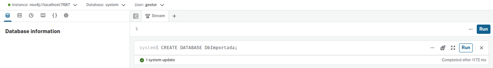
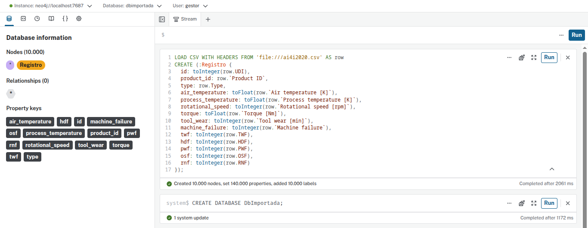
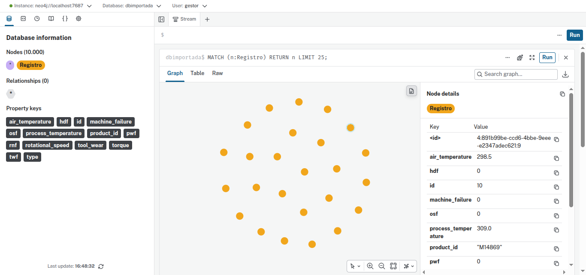
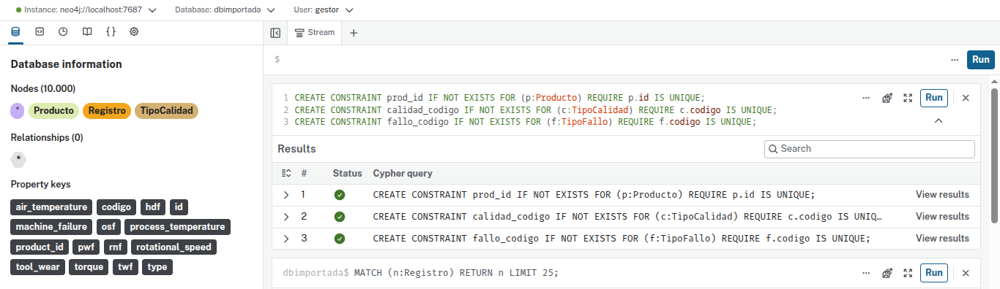
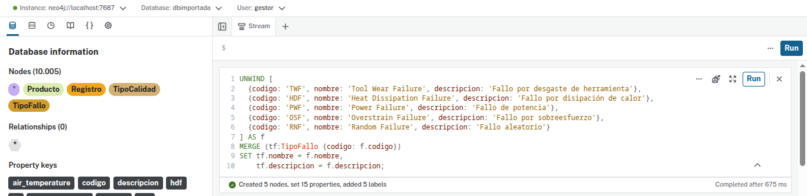
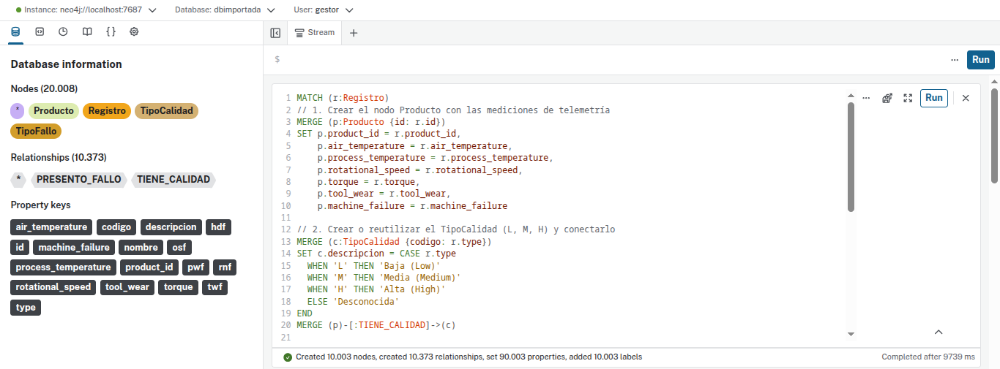
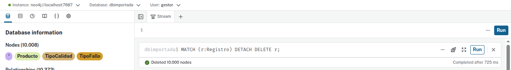
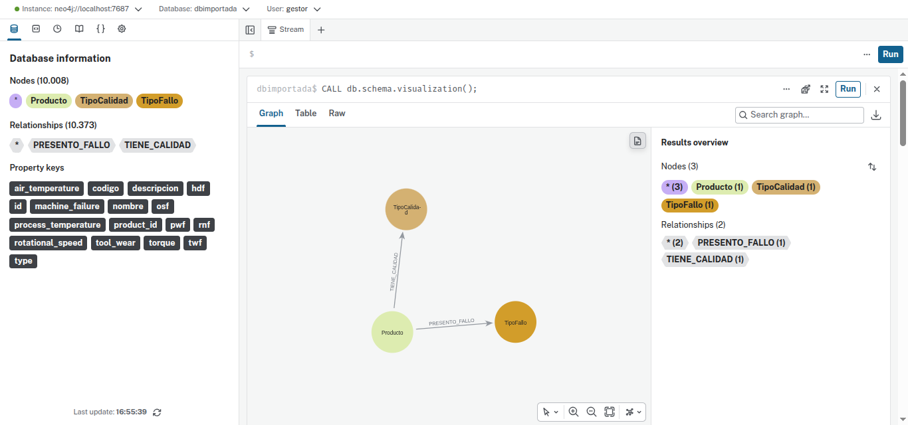
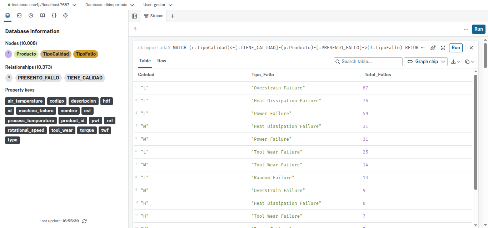

# Práctica 1: Importación y Modelado de una Base de Datos en Neo4j

**Sergio Emanuel Soberano Paredes**  
**Numero de Control:** 22020838  
**Asignatura:** Bases de Datos NoSQL
**Fecha:** 24 de noviembre del 2026  

---

## Índice
1. [Introducción](#introducción)
2. [Descripción del Dataset](#descripción-del-dataset)
3. [Entorno de Trabajo](#entorno-de-trabajo)
4. [Paso 1: Creación de la Base de Datos](#paso-1-creación-de-la-base-de-datos)
5. [Paso 2: Ingesta de Datos desde CSV](#paso-2-ingesta-de-datos-desde-csv)
6. [Paso 3: Consulta y Exploración Inicial](#paso-3-consulta-y-exploración-inicial)
7. [Paso 4: Modelado y Transformación hacia Grafo](#paso-4-modelado-y-transformación-hacia-grafo)
   - [4.1 Creación de Restricciones de Unicidad](#41-creación-de-restricciones-de-unicidad)
   - [4.2 Catalogación de Modos de Fallo](#42-catalogación-de-modos-de-fallo)
   - [4.3 Generación de Nodos y Relaciones](#43-generación-de-nodos-y-relaciones)
   - [4.4 Depuración de Nodos Temporales](#44-depuración-de-nodos-temporales)
8. [Paso 5: Visualización del Esquema y Análisis de Resultados](#paso-5-visualización-del-esquema-y-análisis-de-resultados)
   - [5.1 Esquema Visual del Grafo](#51-esquema-visual-del-grafo)
   - [5.2 Consulta Analítica de Conteo de Fallos por Calidad](#52-consulta-analítica-de-conteo-de-fallos-por-calidad)
9. [Conclusiones](#conclusiones)

---

## Introducción

Las bases de datos orientadas a grafos, como Neo4j, destacan por su capacidad para representar y consultar entidades fuertemente interconectadas mediante nodos, propiedades y relaciones etiquetadas y dirigidas. Sin embargo, en el mundo real, la mayoría de las fuentes de datos provienen de entornos tabulares, como hojas de cálculo o archivos delimitados por comas (CSV).

El objetivo de esta práctica es llevar a cabo la importación de un conjunto de datos tabular masivo en Neo4j mediante la cláusula `LOAD CSV`, para posteriormente aplicar un proceso de transformación y modelado (ETL) que convierta una estructura plana en un grafo semánticamente rico, normalizado y optimizado para consultas de grafos complejas.

---

## Descripción del Dataset

El conjunto de datos utilizado corresponde al **AI4I 2020 Predictive Maintenance Dataset**, un conjunto de datos enfocado en mantenimiento predictivo industrial. El archivo consta de 10,000 registros y contiene las siguientes columnas principales:

- **UDI / id:** Identificador único de fila (1 a 10,000).
- **Product ID:** Identificador del producto compuesto por la variante de calidad y número de serie (p. ej. `M14860`).
- **Type:** Variante de calidad del producto: `L` (Low - 50%), `M` (Medium - 30%), `H` (High - 20%).
- **Air temperature [K]:** Temperatura del aire ambiente.
- **Process temperature [K]:** Temperatura de operación del proceso.
- **Rotational speed [rpm]:** Velocidad angular del motor.
- **Torque [Nm]:** Torque generado.
- **Tool wear [min]:** Desgaste acumulado de la herramienta de corte en minutos.
- **Machine failure:** Bandera binaria que indica si ocurrió una falla en la máquina.
- **Modos de fallo específicos (TWF, HDF, PWF, OSF, RNF):**
  - **TWF** (*Tool Wear Failure*): Falla por desgaste de la herramienta.
  - **HDF** (*Heat Dissipation Failure*): Falla por disipación térmica insuficiente.
  - **PWF** (*Power Failure*): Falla por exceso o defecto de potencia.
  - **OSF** (*Overstrain Failure*): Falla por sobreesfuerzo o tensión mecánica.
  - **RNF** (*Random Failure*): Falla atribuible a factores aleatorios no parametrizados.

---

## Entorno de Trabajo

- **Servidor Neo4j:** Conexión local en `neo4j://localhost:7687`.
- **Cliente:** Neo4j Browser.
- **Usuario Gestor:** `gestor`.
- **Bases de datos:** `system` (para tareas administrativas) y `DbImportada` (para la práctica).

---

## Paso 1: Creación de la Base de Datos

En arquitecturas multi-base de datos de Neo4j, las operaciones de creación y administración de bases de datos deben realizarse conectados al contexto de la base de datos `system`.

Se ejecutó el comando para instanciar la base de datos de trabajo:

```cypher
CREATE DATABASE DbImportada;
```



*Figura 1: Creación exitosa de la base de datos `DbImportada` en el catálogo de Neo4j.*

---

## Paso 2: Ingesta de Datos desde CSV

Una vez creada la base de datos, se cambia el contexto a `dbimportada`. Se utilizó la cláusula `LOAD CSV WITH HEADERS` para importar el archivo `ai4i2020.csv` ubicado en el directorio de importación configurado en el servidor Neo4j (`import/`).

Durante esta etapa se creó un nodo de almacenamiento temporal con la etiqueta `:Registro` por cada fila del archivo CSV, haciendo las conversiones de tipo correspondientes (`toInteger`, `toFloat`) para asegurar la tipificación de los datos numéricos:

```cypher
LOAD CSV WITH HEADERS FROM 'file:///ai4i2020.csv' AS row
CREATE (:Registro {
  id: toInteger(row.UDI),
  product_id: row.`Product ID`,
  type: row.Type,
  air_temperature: toFloat(row.`Air temperature [K]`),
  process_temperature: toFloat(row.`Process temperature [K]`),
  rotational_speed: toInteger(row.`Rotational speed [rpm]`),
  torque: toFloat(row.`Torque [Nm]`),
  tool_wear: toInteger(row.`Tool wear [min]`),
  machine_failure: toInteger(row.`Machine failure`),
  twf: toInteger(row.TWF),
  hdf: toInteger(row.HDF),
  pwf: toInteger(row.PWF),
  osf: toInteger(row.OSF),
  rnf: toInteger(row.RNF)
});
```



*Figura 2: Ingesta de 10,000 registros con 140,000 propiedades asignadas.*

---

## Paso 3: Consulta y Exploración Inicial

Para constatar que los datos se importaron fielmente, se lanzó una consulta preliminar limitando los resultados a 25 registros:

```cypher
MATCH (n:Registro) RETURN n LIMIT 25;
```



*Figura 3: Exploración inicial de los nodos temporales `:Registro`. Se observa que son nodos planos sin ninguna relación entre sí.*

Como se evidencia en la visualización, los nodos se encuentran completamente desconectados. Esto demuestra la naturaleza tabular de la carga original, lo que motiva el siguiente paso de modelado en grafo.

---

## Paso 4: Modelado y Transformación hacia Grafo

El objetivo del modelado en grafos es descomponer las tablas planas en entidades maestras (nodos) y definir las relaciones explícitas que describen la interacción entre ellas. El diseño de destino contempla:
- **`Producto`:** Cada máquina/producto procesado con sus atributos de telemetría operativa.
- **`TipoCalidad`:** Clasificación según variante de fabricación (`L`, `M`, `H`).
- **`TipoFallo`:** Catálogo de los tipos de fallas mecánicas y operativas.
- **Relaciones:**
  - `(:Producto)-[:TIENE_CALIDAD]->(:TipoCalidad)`
  - `(:Producto)-[:PRESENTO_FALLO]->(:TipoFallo)`

### 4.1 Creación de Restricciones de Unicidad

Antes de realizar la transformación, se crearon restricciones de unicidad (`CONSTRAINT`) sobre los identificadores de los nodos clave. Esto garantiza la integridad referencial y genera automáticamente índices para optimizar los comandos `MERGE`:

```cypher
CREATE CONSTRAINT prod_id IF NOT EXISTS FOR (p:Producto) REQUIRE p.id IS UNIQUE;
CREATE CONSTRAINT calidad_codigo IF NOT EXISTS FOR (c:TipoCalidad) REQUIRE c.codigo IS UNIQUE;
CREATE CONSTRAINT fallo_codigo IF NOT EXISTS FOR (f:TipoFallo) REQUIRE f.codigo IS UNIQUE;
```



*Figura 4: Definición de restricciones de unicidad en las entidades Producto, TipoCalidad y TipoFallo.*

### 4.2 Catalogación de Modos de Fallo

Se sembraron en el grafo los nodos correspondientes al catálogo de modos de falla, enriqueciéndolos con sus nombres completos y su descripción técnica en español a través de la instrucción `UNWIND`:

```cypher
UNWIND [
  {codigo: 'TWF', nombre: 'Tool Wear Failure', descripcion: 'Fallo por desgaste de herramienta'},
  {codigo: 'HDF', nombre: 'Heat Dissipation Failure', descripcion: 'Fallo por disipación de calor'},
  {codigo: 'PWF', nombre: 'Power Failure', descripcion: 'Fallo de potencia'},
  {codigo: 'OSF', nombre: 'Overstrain Failure', descripcion: 'Fallo por sobreesfuerzo'},
  {codigo: 'RNF', nombre: 'Random Failure', descripcion: 'Fallo aleatorio'}
] AS f
MERGE (tf:TipoFallo {codigo: f.codigo})
SET tf.nombre = f.nombre,
    tf.descripcion = f.descripcion;
```



*Figura 5: Creación de los 5 nodos maestros para la entidad `TipoFallo`.*

### 4.3 Generación de Nodos y Relaciones

En esta fase se procesaron los nodos intermedios `:Registro` para crear los nodos definitivos `:Producto` y relacionarlos con `:TipoCalidad` y `:TipoFallo`:

```cypher
MATCH (r:Registro)
MERGE (p:Producto {id: r.id})
SET p.product_id = r.product_id,
    p.air_temperature = r.air_temperature,
    p.process_temperature = r.process_temperature,
    p.rotational_speed = r.rotational_speed,
    p.torque = r.torque,
    p.tool_wear = r.tool_wear,
    p.machine_failure = r.machine_failure

MERGE (c:TipoCalidad {codigo: r.type})
SET c.descripcion = CASE r.type
    WHEN 'L' THEN 'Baja (Low)'
    WHEN 'M' THEN 'Media (Medium)'
    WHEN 'H' THEN 'Alta (High)'
    ELSE 'Desconocida'
END
MERGE (p)-[:TIENE_CALIDAD]->(c)

FOREACH (_ IN CASE WHEN r.twf = 1 THEN [1] ELSE [] END |
    MERGE (f:TipoFallo {codigo: 'TWF'})
    MERGE (p)-[:PRESENTO_FALLO]->(f)
)
FOREACH (_ IN CASE WHEN r.hdf = 1 THEN [1] ELSE [] END |
    MERGE (f:TipoFallo {codigo: 'HDF'})
    MERGE (p)-[:PRESENTO_FALLO]->(f)
)
FOREACH (_ IN CASE WHEN r.pwf = 1 THEN [1] ELSE [] END |
    MERGE (f:TipoFallo {codigo: 'PWF'})
    MERGE (p)-[:PRESENTO_FALLO]->(f)
)
FOREACH (_ IN CASE WHEN r.osf = 1 THEN [1] ELSE [] END |
    MERGE (f:TipoFallo {codigo: 'OSF'})
    MERGE (p)-[:PRESENTO_FALLO]->(f)
)
FOREACH (_ IN CASE WHEN r.rnf = 1 THEN [1] ELSE [] END |
    MERGE (f:TipoFallo {codigo: 'RNF'})
    MERGE (p)-[:PRESENTO_FALLO]->(f)
);
```



*Figura 6: Ejecución del modelado, generando 10,003 nodos y 10,373 relaciones en el grafo.*

### 4.4 Depuración de Nodos Temporales

Una vez concluida la migración hacia las entidades del grafo definitivo, los 10,000 nodos temporales con la etiqueta `:Registro` fueron eliminados para liberar espacio y optimizar el almacenamiento:

```cypher
MATCH (r:Registro) DETACH DELETE r;
```



*Figura 7: Eliminación de los 10,000 nodos temporales `:Registro`.*

El estado final de la base de datos consta de:
- **Nodos:** 10,008 en total (10,000 `Producto`, 3 `TipoCalidad`, 5 `TipoFallo`).
- **Relaciones:** 10,373 en total (10,000 `TIENE_CALIDAD`, 373 `PRESENTO_FALLO`).

---

## Paso 5: Visualización del Esquema y Análisis de Resultados

### 5.1 Esquema Visual del Grafo

Para comprobar la arquitectura resultante del modelo de datos, se ejecutó el procedimiento del sistema para visualizar el metamodelo:

```cypher
CALL db.schema.visualization();
```



*Figura 8: Metamodelo de la base de datos resultante, mostrando las entidades `Producto`, `TipoCalidad` y `TipoFallo` con sus respectivas conexiones.*

### 5.2 Consulta Analítica de Conteo de Fallos por Calidad

Una ventaja esencial de los grafos es la capacidad de atravesar relaciones de forma eficiente. Se ejecutó una consulta de agregación para determinar qué tipos de fallos ocurren con mayor frecuencia según la calidad del producto:

```cypher
MATCH (c:TipoCalidad)<-[:TIENE_CALIDAD]-(p:Producto)-[:PRESENTO_FALLO]->(f:TipoFallo)
RETURN c.codigo AS Calidad, f.nombre AS Tipo_Fallo, count(*) AS Total_Fallos
ORDER BY Total_Fallos DESC;
```



*Figura 9: Distribución analítica de la cantidad de fallos clasificados por calidad del producto.*

#### Análisis de los Resultados Obtenidos

De acuerdo con los datos arrojados por la consulta:
1. **Calidad Baja (`L`):** Concentra la mayor incidencia de fallas mecánicas severas, destacando el sobreesfuerzo (*Overstrain Failure* con 87 eventos), disipación de calor (*Heat Dissipation Failure* con 76 eventos) y falla de potencia (*Power Failure* con 59 eventos).
2. **Calidad Media (`M`):** Presenta una disminución sustancial respecto a la baja calidad, con 31 fallas por disipación térmica y 31 de potencia.
3. **Calidad Alta (`H`):** Registra el menor número de fallas (únicamente 8 por disipación de calor y 7 por desgaste de herramienta), lo que evidencia la mayor tolerancia y robustez de los componentes de alta gama.

---

## Conclusiones

1. **Eficiencia en la Carga Masiva:** La sentencia `LOAD CSV` combinada con funciones de conversión de tipos permite ingerir grandes volúmenes de datos directamente a Neo4j de manera ágil.
2. **Estrategia de Staging:** Cargar inicialmente los datos a una etiqueta temporal (`:Registro`) y posteriormente transformarla hacia el modelo objetivo en grafo es una práctica recomendada en procesos ETL complejos, pues minimiza conflictos y permite validar los datos antes de crear las relaciones.
3. **Poder del Modelo de Grafos:** La transición de un modelo plano a un modelo conectado con `Producto`, `TipoCalidad` y `TipoFallo` eliminó redundancias y simplificó consultas complejas de análisis predictivo, permitiendo extraer correlaciones de causa-efecto mediante patrones de lectura simples e intuitivos en Cypher.
