# Práctica 2: Gestión de Usuarios y Control de Acceso Basado en Roles (RBAC) en Neo4j

**Sergio Emanuel Soberano Paredes**  
**Numero de Control:** 22020838  
**Asignatura:** Bases de Datos NoSQL
**Fecha:** 24 de noviembre del 2026  

---

## Índice
1. [Introducción](#introducción)
2. [Conceptos de Seguridad en Neo4j: RBAC](#conceptos-de-seguridad-en-neo4j-rbac)
3. [Entorno de Trabajo y Datos Base](#entorno-de-trabajo-y-datos-base)
4. [Paso 1: Creación de la Base de Datos](#paso-1-creación-de-la-base-de-datos)
5. [Paso 2: Creación de Usuarios](#paso-2-creación-de-usuarios)
6. [Paso 3: Asignación de Roles](#paso-3-asignación-de-roles)
7. [Paso 4: Auditoría y Verificación de Usuarios y Roles](#paso-4-auditoría-y-verificación-de-usuarios-y-roles)
   - [4.1 Consulta de Roles del Sistema](#41-consulta-de-roles-del-sistema)
   - [4.2 Consulta de Usuarios y Privilegios](#42-consulta-de-usuarios-y-privilegios)
8. [Paso 5: Validación Experimental de Privilegios por Usuario](#paso-5-validación-experimental-de-privilegios-por-usuario)
   - [5.1 Pruebas con el Usuario `lector` (Rol `reader`)](#51-pruebas-con-el-usuario-lector-rol-reader)
   - [5.2 Pruebas con el Usuario `editor` (Rol `editor`)](#52-pruebas-con-el-usuario-editor-rol-editor)
   - [5.3 Pruebas con el Usuario `gestor` (Rol `admin`)](#53-pruebas-con-el-usuario-gestor-rol-admin)
9. [Matriz Comparativa de Privilegios](#matriz-comparativa-de-privilegios)
10. [Conclusiones](#conclusiones)

---

## Introducción

En entornos empresariales y de producción, la seguridad de la información es un pilar crítico. Las bases de datos no solo deben almacenar y procesar datos eficientemente, sino que deben garantizar que cada usuario acceda únicamente a los recursos y operaciones estrictamente indispensables para su función (principio de menor privilegio).

Neo4j implementa un esquema de **Control de Acceso Basado en Roles (RBAC, por sus siglas en inglés)** que permite asociar privilegios específicos a roles predefinidos o personalizados, y luego asignar dichos roles a los usuarios del sistema. El propósito de esta práctica es crear y configurar tres usuarios con niveles de acceso diferenciados (`lector`, `editor` y `gestor`), asignarles los roles correspondientes (`reader`, `editor` y `admin`), y someter a prueba sus capacidades tanto de lectura, modificación de datos (DML) y alteración de esquema o índices (DDL).

---

## Conceptos de Seguridad en Neo4j: RBAC

Neo4j ofrece distintos roles nativos del sistema que encapsulan conjuntos estándar de privilegios:

1. **`reader`:** Otorga permisos exclusivos de lectura sobre los grafos y datos de la base de datos (`MATCH`, `RETURN`). No permite crear, modificar ni eliminar nodos, relaciones ni propiedades, ni realizar modificaciones de esquema.
2. **`editor`:** Permite leer y además realizar operaciones de manipulación de datos (`CREATE`, `SET`, `DELETE`, `MERGE` sobre nodos y relaciones). Sin embargo, carece de privilegios administrativos para modificar el esquema del grafo (como crear restricciones o índices) o administrar la configuración del servidor.
3. **`admin`:** Otorga privilegios completos de administración, lectura, escritura y modificación de esquema (creación/eliminación de índices, constraints, gestión de bases de datos, etc.).
4. **`PUBLIC`:** Rol base asignado automáticamente a todos los usuarios del sistema, que contiene privilegios elementales para la interacción inicial con la sesión.

---

## Entorno de Trabajo y Datos Base

- **Servidor Neo4j:** Conexión local en `neo4j://localhost:7687`.
- **Cliente:** Neo4j Browser (`http://localhost:7474/browser/`).
- **Base de datos de práctica:** `clase`, poblada con el grafo estándar de películas (*Movie Graph*), el cual cuenta con nodos etiquetados como `:Movie` y `:Person`, y relaciones como `:ACTED_IN`, `:DIRECTED`, `:PRODUCED`, `:WRITTEN`, entre otras.

---

## Paso 1: Creación de la Base de Datos

Para aislar las pruebas de los usuarios y permisos, se inició sesión como superusuario administrativo (`neo4j`), se cambió el contexto a la base de datos administrativa `system` y se creó la base de datos de trabajo denominada `clase`:

```cypher
:use system;
CREATE DATABASE clase IF NOT EXISTS;
```

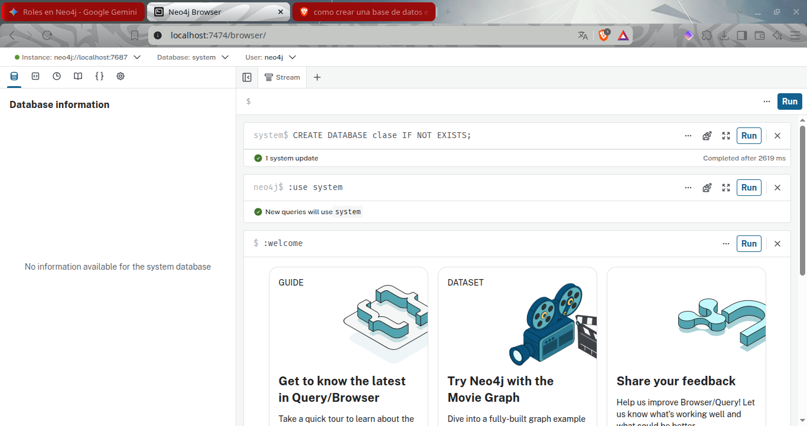

*Figura 1: Creación de la base de datos `clase` en el contexto administrativo `system`.*

---

## Paso 2: Creación de Usuarios

A continuación, se definieron tres cuentas de usuario en el sistema. Para evitar la solicitud obligatoria de rotación de credenciales en el primer inicio de sesión durante las pruebas, se utilizó la cláusula `SET PASSWORD CHANGE NOT REQUIRED`:

```cypher
CREATE USER lector SET PASSWORD 'password' SET PASSWORD CHANGE NOT REQUIRED;
CREATE USER editor SET PASSWORD 'password' SET PASSWORD CHANGE NOT REQUIRED;
CREATE USER gestor SET PASSWORD 'password' SET PASSWORD CHANGE NOT REQUIRED;
```

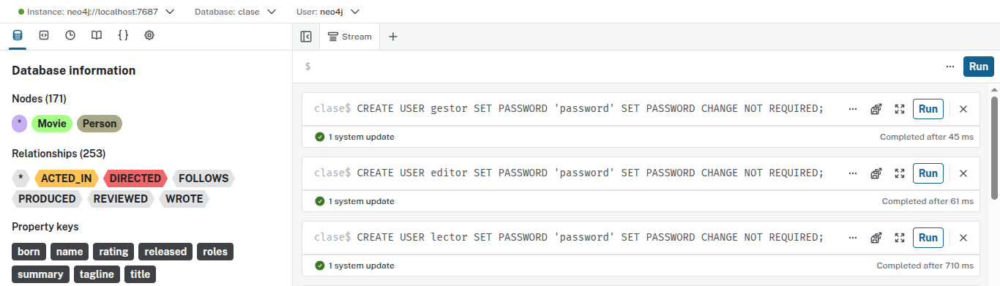

*Figura 2: Creación exitosa de los usuarios `lector`, `editor` y `gestor`.*

---

## Paso 3: Asignación de Roles

Con los usuarios instanciados, se procedió a vincular a cada uno con su respectivo rol de seguridad mediante la sentencia `GRANT ROLE`:

- Al usuario **`lector`** se le otorgó el rol **`reader`** (solo lectura).
- Al usuario **`editor`** se le otorgó el rol **`editor`** (lectura y escritura de datos).
- Al usuario **`gestor`** se le otorgó el rol **`admin`** (administración completa y control de esquema).

```cypher
GRANT ROLE reader TO lector;
GRANT ROLE editor TO editor;
GRANT ROLE admin TO gestor;
```

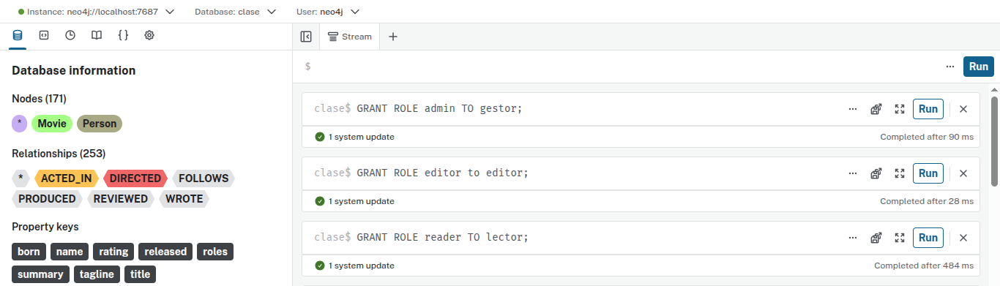

*Figura 3: Asignación de los roles `reader`, `editor` y `admin` a los usuarios respectivos.*

---

## Paso 4: Auditoría y Verificación de Usuarios y Roles

### 4.1 Consulta de Roles del Sistema

Para consultar el catálogo de roles disponibles y activos en la instancia de Neo4j, se ejecutó:

```cypher
SHOW ROLES;
```

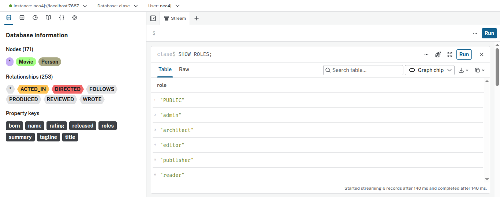

*Figura 4: Roles nativos registrados en el catálogo de Neo4j (`PUBLIC`, `admin`, `architect`, `editor`, `publisher`, `reader`).*

### 4.2 Consulta de Usuarios y Privilegios

Para verificar que las cuentas de usuario se encuentran activas y con los roles correctamente asignados, se ejecutó la instrucción de auditoría:

```cypher
SHOW USERS;
```

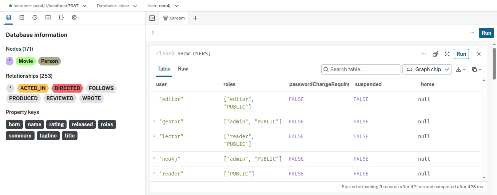

*Figura 5: Listado de usuarios activos, roles asociados y estado de contraseña en el sistema.*

Se constata la estructura de asignación de roles:
- `editor` $\rightarrow$ `["editor", "PUBLIC"]`
- `gestor` $\rightarrow$ `["admin", "PUBLIC"]`
- `lector` $\rightarrow$ `["reader", "PUBLIC"]`
- `neo4j` $\rightarrow$ `["admin", "PUBLIC"]`

---

## Paso 5: Validación Experimental de Privilegios por Usuario

Para comprobar de manera práctica el aislamiento de permisos y la efectividad de las políticas de seguridad RBAC, se inició sesión con cada una de las cuentas creadas y se ejecutaron consultas representativas.

---

### 5.1 Pruebas con el Usuario `lector` (Rol `reader`)

El usuario `lector` únicamente debe tener autorización para consultar información existente.

#### Prueba 1: Consulta de lectura
Se ejecutó una consulta para encontrar la red de películas y directores asociados al actor Tom Hanks:

```cypher
MATCH (person:Person {name: 'Tom Hanks'}) 
MATCH path = (person)-[:ACTED_IN]->(m)<-[:DIRECTED]-(d) 
RETURN path;
```

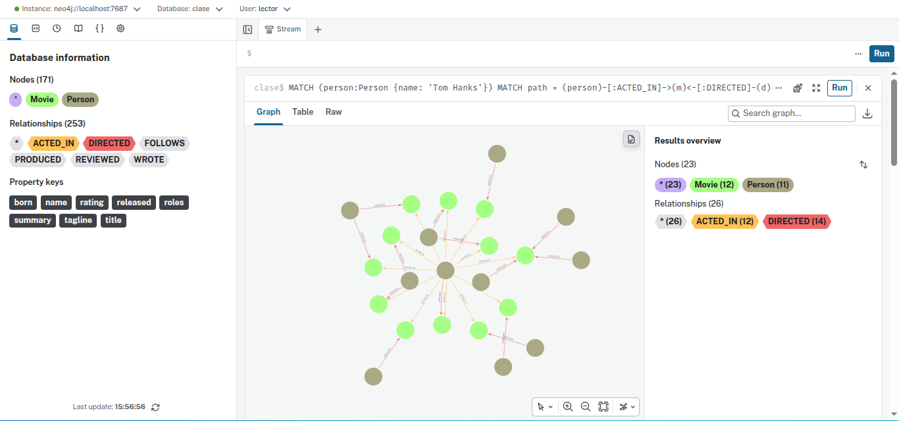

*Figura 6: El usuario `lector` consulta y visualiza exitosamente 23 nodos y 26 relaciones del grafo.*

#### Prueba 2: Intento de modificación de esquema (Creación de Índices)
Se intentó crear dos índices sobre las propiedades `Person.born` y `Movie.released`:

```cypher
CREATE INDEX person_born IF NOT EXISTS FOR (p:Person) ON (p.born);
CREATE INDEX movie_released IF NOT EXISTS FOR (m:Movie) ON (m.released);
```

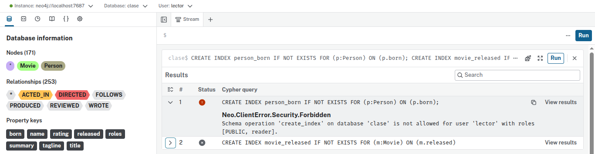

*Figura 7: Denegación de acceso al usuario `lector` por violación de privilegios de seguridad.*

**Resultado:** El motor de seguridad de Neo4j bloqueó inmediatamente la transacción emitiendo la excepción:
```
Neo.ClientError.Security.Forbidden:
Schema operation 'create_index' on database 'clase' is not allowed for user 'lector' with roles [PUBLIC, reader].
```
Esto confirma que el rol `reader` protege la integridad del esquema impidiendo cualquier operación DDL.

---

### 5.2 Pruebas con el Usuario `editor` (Rol `editor`)

El usuario `editor` debe poder leer y modificar datos del grafo (crear o editar nodos y relaciones), pero sin privilegios administrativos.

#### Prueba 3: Consulta de lectura
Se verificó que el usuario puede realizar consultas de lectura del grafo:

```cypher
MATCH (person:Person {name: 'Tom Hanks'}) 
MATCH path = (person)-[:ACTED_IN]->(m)<-[:DIRECTED]-(d) 
RETURN path;
```

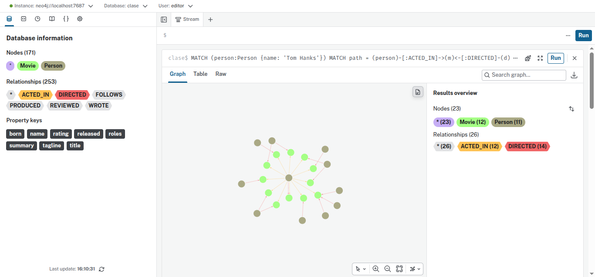

*Figura 8: El usuario `editor` consulta sin impedimentos el grafo de películas.*

#### Prueba 4: Creación de un nuevo nodo (DML)
Se procedió a insertar un nuevo nodo representando al actor *Ben Stiller*:

```cypher
CREATE (:Person {name: "Ben Stiller"});
```

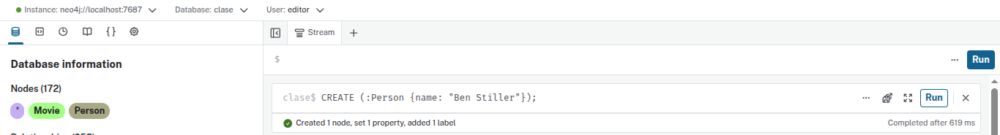

*Figura 9: Creación exitosa del nodo `:Person` por el usuario `editor`, incrementando el conteo de nodos a 172.*

**Resultado:** La transacción se completó con éxito (`Created 1 node, set 1 property, added 1 label`), validando que el rol `editor` tiene privilegios de escritura sobre los datos.

---

### 5.3 Pruebas con el Usuario `gestor` (Rol `admin`)

El usuario `gestor` cuenta con el rol `admin`, por lo que debe poseer control total de lectura, manipulación de datos y gestión de esquema.

#### Prueba 5: Consulta de lectura compleja
Se ejecutó una consulta de recorrido de múltiples saltos a partir del actor Kevin Bacon:

```cypher
MATCH (:Person {name:"Kevin Bacon"})-[*1..6]-(n) 
RETURN DISTINCT n;
```

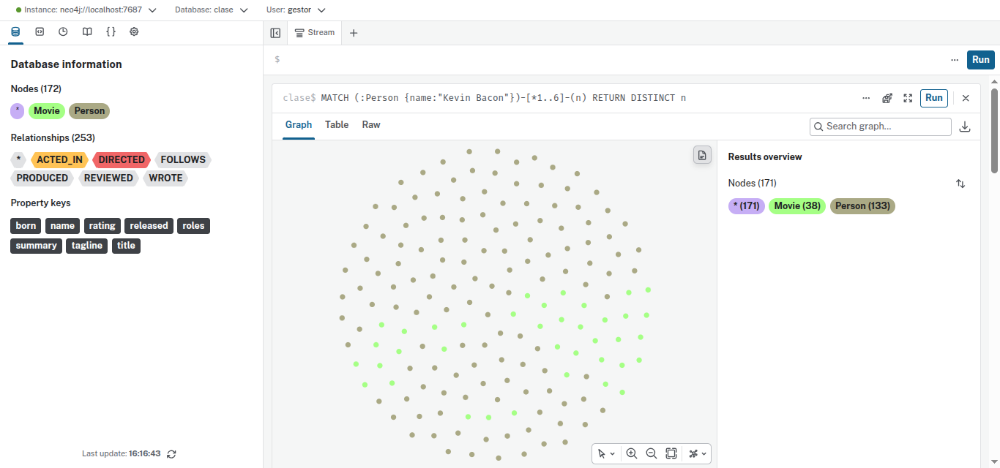

*Figura 10: El usuario `gestor` visualiza exitosamente 171 nodos interconectados en el grafo.*

#### Prueba 6: Creación de un nuevo nodo (DML)
Se insertó una nueva película en el catálogo:

```cypher
CREATE (:Movie {name: "The Secret Life of Walter Mitty"});
```

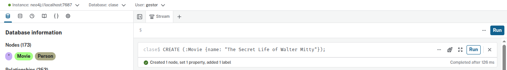

*Figura 11: Inserción exitosa de un nodo `:Movie`, elevando el número de nodos de la base de datos a 173.*

#### Prueba 7: Creación de índices en el esquema (DDL)
Se procedió a ejecutar las mismas instrucciones de creación de índices que fueron denegadas al usuario `lector`:

```cypher
CREATE INDEX person_born IF NOT EXISTS FOR (p:Person) ON (p.born);
CREATE INDEX movie_released IF NOT EXISTS FOR (m:Movie) ON (m.released);
```

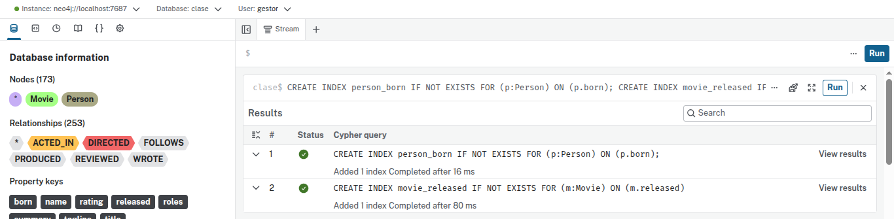

*Figura 12: Creación exitosa de los índices `person_born` y `movie_released` por el usuario `gestor`.*

**Resultado:** Ambos índices se crearon de forma satisfactoria en la base de datos `clase`, comprobando que el rol `admin` otorga facultades plenas sobre el metamodelo y las estructuras de aceleración de consultas.

---

## Matriz Comparativa de Privilegios

La siguiente tabla resume los resultados observados durante las pruebas experimentales de control de acceso:

| Operación / Tipo | Comando Cypher Representativo | Usuario `lector` (`reader`) | Usuario `editor` (`editor`) | Usuario `gestor` (`admin`) |
| :--- | :--- | :---: | :---: | :---: |
| **Lectura (DQL)** | `MATCH (n) RETURN n;` | **Permitido** | **Permitido** | **Permitido** |
| **Escritura (DML)** | `CREATE (:Person {...});` | *Denegado* | **Permitido** | **Permitido** |
| **Esquema (DDL)** | `CREATE INDEX ... ON (...);` | *Denegado* (`Security.Forbidden`) | *Denegado* | **Permitido** |
| **Administración** | `SHOW USERS;` / `CREATE USER ...` | *Denegado* | *Denegado* | **Permitido** |

---

## Conclusiones

1. **Aislamiento Robusto mediante RBAC:** El modelo de roles de Neo4j permite desacoplar los privilegios individuales de los usuarios, centralizando las políticas de acceso en roles estandarizados que facilitan la administración y auditoría del sistema.
2. **Cumplimiento del Principio de Menor Privilegio:** Al restringir a los usuarios analistas o de consulta (`lector`) al rol `reader`, se evita cualquier modificación accidental o maliciosa del contenido y de la estructura de la base de datos.
3. **Diferenciación entre DML y DDL:** Se constató experimentalmente que el rol `editor` permite a las aplicaciones o usuarios de negocio insertar y actualizar datos en el grafo sin exponer el riesgo de alterar índices, restricciones o configuraciones del motor, tareas reservadas exclusivamente al rol `admin`.
